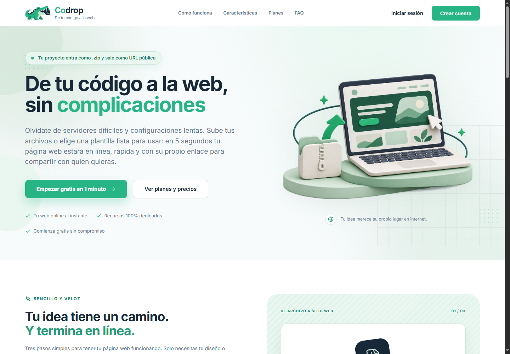
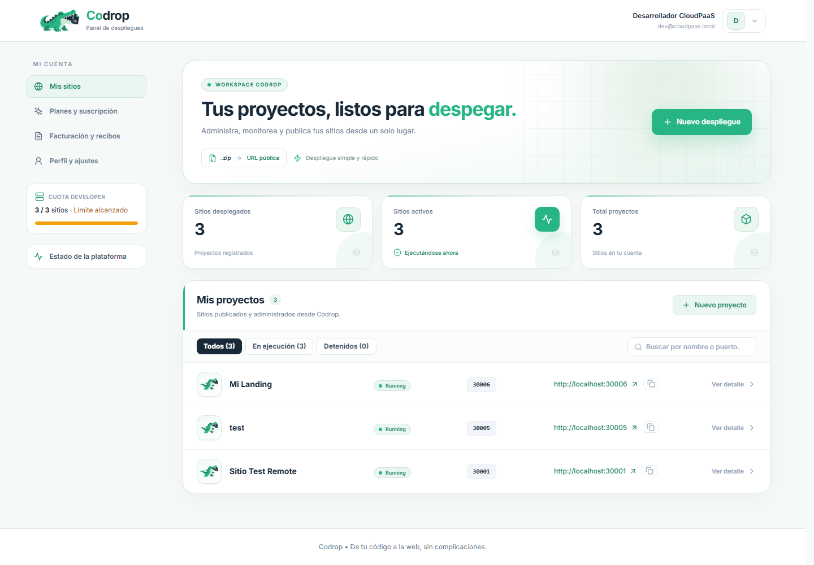
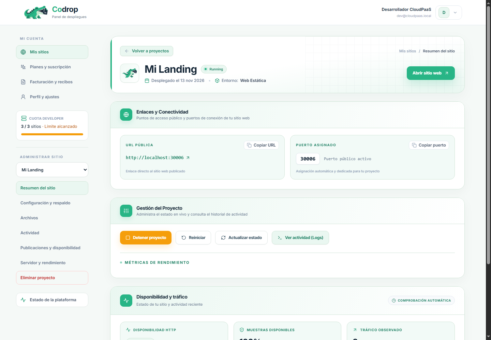
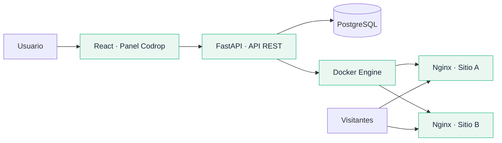

<div align="center">

  

  <p align="center">
    <strong>Web Hosting as a Service (PaaS)</strong>
  </p>
  <p align="center">
    Aprovisionamiento automatizado, aislado y seguro de servidores web dedicados para aplicaciones estáticas y SPAs mediante contenedores ligeros Nginx Alpine.
  </p>

  <p align="center">
    <a href="#overview">Overview</a> •
    <a href="#key-features">Features</a> •
    <a href="#architecture">Architecture</a> •
    <a href="#tech-stack">Tech Stack</a> •
    <a href="#getting-started">Getting Started</a> •
    <a href="#configuration">Configuration</a> •
    <a href="#api-reference">API Reference</a> •
    <a href="#development--testing">Testing</a>
  </p>

  <p align="center">
    
    
    
    
    
    
    
    
    
  </p>

</div>

---

## Overview

**De tu código a la web, sin complicaciones.** Codrop convierte un archivo `.zip` o una plantilla en un sitio publicado, con su propio contenedor y una dirección lista para compartir.

Está pensado para portafolios, landing pages, documentación y aplicaciones estáticas o SPAs. Tú eliges qué publicar; Codrop reúne despliegue, versiones, estado y administración en un mismo lugar.

<p align="center">
  
</p>

| 01 · Publica | 02 · Administra | 03 · Comparte |
| :--- | :--- | :--- |
| Sube tu `.zip` o elige una plantilla. | Revisa el estado, actualiza archivos y consulta tus versiones. | Abre tu enlace público y muestra tu proyecto. |

## Key Features

| Tu proyecto, desde un solo panel | Lo que puedes hacer |
| :--- | :--- |
| **Publicación sencilla** | ZIP de hasta 25 MB, plantillas en un clic y soporte para rutas de SPAs. |
| **Un espacio para cada sitio** | Contenedor Nginx dedicado, recursos limitados y archivos montados en solo lectura. |
| **Versiones y respaldos** | Publicar actualizaciones, restaurar una versión guardada y descargar el contenido activo. |
| **Estado y actividad** | CPU/RAM, comprobaciones HTTP, registros recientes de Nginx e historial del proyecto. |
| **Cuenta y suscripción** | Verificación de correo, recuperación de contraseña, cuotas por plan y comprobantes. |
| **Administración** | Vista global del host y acciones administrativas con registro de auditoría. |

### Una interfaz que habla tu idioma

<table>
  <tr>
    <td width="50%"></td>
    <td width="50%"></td>
  </tr>
  <tr>
    <td align="center"><strong>Tus proyectos, a primera vista</strong><br /><sub>Estados claros, cuotas y accesos rápidos.</sub></td>
    <td align="center"><strong>Cada sitio, bajo control</strong><br /><sub>Conexión, archivos, versiones y rendimiento.</sub></td>
  </tr>
</table>

<sub>Capturas de la cuenta de demostración. Las direcciones privadas se muestran como localhost.</sub>

<details>
<summary><strong>Una mascota con propósito</strong></summary>

La mascota acompaña los estados del servicio y aparece de forma discreta en las vistas públicas.

| Creando | En ejecución | Detenido | Error | Eliminando |
| :---: | :---: | :---: | :---: | :---: |
|  |  |  |  |  |

[Variaciones e identidad visual](frontend/MASCOT_VARIATIONS_PROMPTS.md).

</details>

## Getting Started

### Instala tu propia plataforma

Necesitas un host **Linux con Docker Engine y Docker Compose v2**, Git y permisos para preparar `/srv/hosting`. La API requiere PostgreSQL; los sitios publicados usan por defecto los puertos `30001–30100`.

```bash
git clone https://github.com/Rtdassh/web-hosting.git codrop
cd codrop
cp .env.example .env
```

Configura `SECRET_KEY` y `POSTGRES_PASSWORD` con valores propios. Ajusta `HOST_PUBLIC_IP` al host accesible por tus usuarios y `FRONTEND_URL` / `PASSWORD_RESET_FRONTEND_URL` a la URL de la plataforma. Para verificar cuentas y recuperar contraseñas, configura Brevo o SMTP. Consulta [la configuración del backend](docs/CONFIGURACION_BACKEND.md).

<details>
<summary><strong>Primera instalación: prepara almacenamiento, base y servicios</strong></summary>

Estos comandos son para una base **nueva y vacía**. Si ya tienes datos, utiliza la [guía de migraciones](docs/MIGRACIONES_ALEMBIC.md) y el procedimiento correspondiente al esquema existente.

```bash
sudo mkdir -p /srv/hosting/instancias /srv/hosting/plantillas
sudo cp -R infra/host-storage/templates/. /srv/hosting/plantillas/

docker build -t cloudpaas/nginx-hosting:latest infra/docker/instance-nginx
docker compose -f docker-compose.prod.yml build
docker compose -f docker-compose.prod.yml up -d --wait paas_db

# Aplicar el esquema explícitamente; el arranque de la API no lo modifica.
docker compose -f docker-compose.prod.yml run --rm --no-deps paas_backend \
  python -m alembic -c alembic.ini -x use_project_database=true upgrade head

# Crear los planes y el pool de puertos; no crea cuentas de demostración.
docker compose -f docker-compose.prod.yml run --rm --no-deps paas_backend \
  python -m app.seed --use-project-database

docker compose -f docker-compose.prod.yml up -d
curl --fail http://localhost/api/v1/plans
```

Abre **http://localhost** para usar Codrop y **http://localhost/docs** para explorar la API. El alta de usuarios se realiza desde la interfaz. La dirección de cada sitio utiliza `HOST_PUBLIC_IP` y su puerto asignado.

Para métricas de disponibilidad cuando la API corre dentro de Docker, revisa la configuración de `MONITOR_HOST` y la conectividad hacia el host en [la guía operativa](docs/MEJORAS_SIN_COSTO.md).

</details>

<details>
<summary><strong>Desarrollo local: API y frontend por separado</strong></summary>

Requisitos adicionales: Python 3.11+, Node.js 22 y pnpm 10.5.2. Configura PostgreSQL y Docker conforme a tu entorno antes de iniciar la API.

```bash
docker compose -f docker-compose.dev.yml up -d postgres
cp frontend/.env.example frontend/.env

cd backend
python -m venv .venv
source .venv/bin/activate
pip install -r requirements-dev.txt
# Para una base local nueva: aplicar Alembic y seed como indica la guía de migraciones.
uvicorn app.main:app --reload
```

En otra terminal:

```bash
cd frontend
pnpm install --frozen-lockfile
pnpm dev
```

Frontend: **http://localhost:5173** · API: **http://localhost:8000**. Vite reenvía `/api` al backend. En Windows, activa el entorno con `.venv\Scripts\Activate.ps1` en lugar de `source`.

</details>

## Architecture



El backend controla identidad, cuotas, artefactos y contenedores mediante el SDK de Docker. El aprovisionamiento configura una red separada del plano de control, límites de recursos, usuario no privilegiado y almacenamiento de contenido en solo lectura. El estado de las instancias heredadas se detalla en la [validación final](docs/VALIDACION_FINAL.md#estado-de-los-contenedores-existentes).

[Requisitos del sistema](docs/SRS_Codrop.md) · [Infraestructura y operación](docs/MANUAL_TECNICO_INFRAESTRUCTURA.md)

## Tech Stack

<details>
<summary><strong>Las herramientas detrás de Codrop</strong></summary>

| Capa | Herramientas |
| :--- | :--- |
| Interfaz | React 18, Vite, Tailwind CSS, Lucide y Axios |
| API y validación | Python, FastAPI y Pydantic |
| Persistencia | PostgreSQL, SQLAlchemy y Alembic |
| Ejecución | Docker SDK y Nginx Alpine |
| Correo | Brevo o SMTP |
| Pruebas | Pytest y Vitest / Testing Library |

Las dependencias exactas se declaran en [requirements.txt](backend/requirements.txt), [requirements-dev.txt](backend/requirements-dev.txt) y [package.json](frontend/package.json).

</details>

## Configuration

Toda la configuración parte de [.env.example](.env.example). Los secretos y las rutas de despliegue se establecen fuera del código fuente.

| Si necesitas… | Consulta |
| :--- | :--- |
| Configurar autenticación y correo | [Configuración del backend](docs/CONFIGURACION_BACKEND.md) |
| Preparar o actualizar la base de datos | [Migraciones Alembic](docs/MIGRACIONES_ALEMBIC.md) |
| Operar versiones, respaldos, monitoreo o HTTPS | [Guía operativa](docs/MEJORAS_SIN_COSTO.md) |
| Entender planes y cuotas | [Precios y valor](docs/PRECIOS_Y_VALOR.md) |
| Revisar el alcance del checkout | [Facturación simulada](docs/FACTURACION_SIMULADA.md) |

**Alcance de esta entrega.** Codrop aloja sitios estáticos y SPAs en un host Docker. El checkout es una simulación académica: valida tarjetas de prueba, pero no procesa cobros bancarios. El monitoreo refleja comprobaciones desde el host y logs recientes; no representa un SLA ni analítica histórica de visitantes. HTTPS y dominios requieren la configuración adicional descrita en la guía operativa.

## API Reference

La documentación interactiva está en `/docs` y el contrato OpenAPI en `/api/v1/openapi.json`. En el compose de producción se accede a ambos desde el mismo origen que la web; con Uvicorn local, desde el puerto `8000`.

```bash
# Verificar que la API responde y consultar el catálogo público.
curl --fail http://localhost/api/v1/plans
```

Las operaciones privadas requieren `Authorization: Bearer <token>` y comprueban la propiedad del sitio o el rol administrador. Los ejemplos, esquemas y respuestas actualizados se consultan en Swagger.

## Development & Testing

```bash
# Desde backend, con el entorno virtual activo y requirements-dev.txt instalado.
python -m pytest tests -q

# Desde frontend.
pnpm test
pnpm build
```

Las pruebas PostgreSQL se activan explícitamente sobre fixtures aisladas; el procedimiento está en la [guía de migraciones](docs/MIGRACIONES_ALEMBIC.md#pruebas-locales-aisladas). No se ejecutan contra la base de usuarios.

[Verificación final de la entrega](docs/VALIDACION_FINAL.md)

## Project Structure

```text
backend/    API, servicios, modelos, migraciones y pruebas
frontend/   Interfaz React, componentes y sistema visual
infra/      Contenedores, plantillas y herramientas de operación
samples/    Sitios y paquetes de ejemplo
docs/       Guías técnicas, requisitos y evidencias
```

## Licencia

Proyecto académico de ingeniería de software. El repositorio no incluye una licencia de código abierto; consulta con el mantenedor antes de reutilizar o redistribuir su código.

<div align="center">
  
  <p><strong>Codrop · De tu código a la web.</strong></p>
</div>
