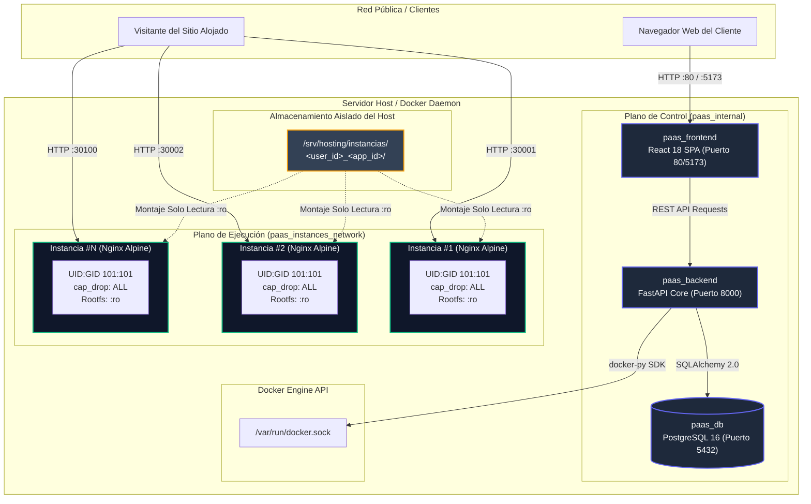
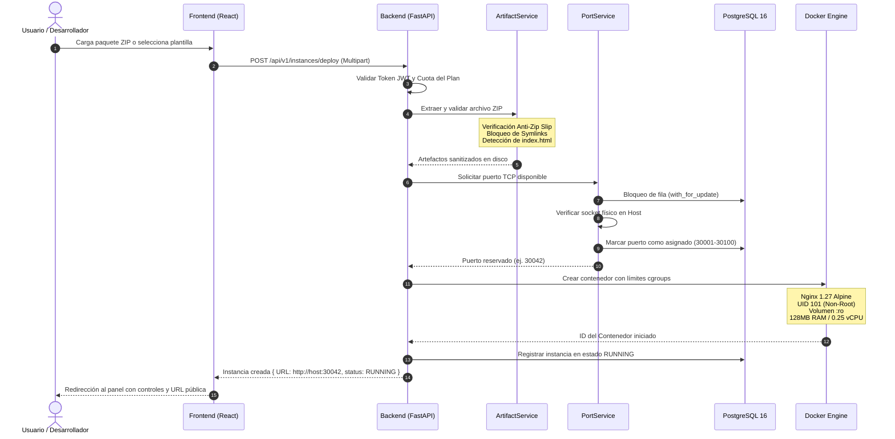

<div align="center">

  

  <p align="center">
    <strong>Web Hosting as a Service (PaaS)</strong>
  </p>
  <p align="center">
    Aprovisionamiento automatizado, aislado y seguro de servidores web dedicados para aplicaciones estáticas y SPAs mediante contenedores ligeros Nginx Alpine.
  </p>

  <p align="center">
    <a href="#overview">Overview</a> •
    <a href="#key-features">Features</a> •
    <a href="#architecture">Architecture</a> •
    <a href="#tech-stack">Tech Stack</a> •
    <a href="#getting-started">Getting Started</a> •
    <a href="#configuration">Configuration</a> •
    <a href="#api-reference">API Reference</a> •
    <a href="#development--testing">Testing</a>
  </p>

  <p align="center">
    
    
    
    
    
    
    
    
    
  </p>

</div>

---

## Overview

**Codrop** es una Plataforma como Servicio (**PaaS**) moderna y minimalista diseñada para resolver la fricción del despliegue y gestión de sitios web estáticos (`HTML5`, `CSS3`, `JavaScript`, `SPAs`). A diferencia de arquitecturas monolíticas o soluciones de hosting compartido que mezclan código de múltiples usuarios en un mismo proceso, Codrop proporciona **aislamiento estricto a nivel de kernel** creando un contenedor Docker dedicado por cada sitio web publicado.

El sistema encapsula la complejidad de Docker Engine, la gestión dinámica de puertos TCP y la seguridad perimetral detrás de una interfaz web intuitiva y una API REST de alto rendimiento. Con soporte para despliegues instantáneos mediante archivos `.zip` o plantillas prediseñadas en un clic, Codrop democratiza el autoservicio de infraestructura para desarrolladores y startups.

### Propuesta de Valor y Métricas Operativas

- **Aprovisionamiento en Excelente Tiempo:** Despliegue de un servidor web dedicado en menos de 3 segundos.
- **Huella de Memoria Ultraligera:** Consumo en reposo menor a 10 MB de RAM por instancia gracias a la optimización sobre Alpine Linux.
- **Confinamiento Multi-Tenant de Grado Empresarial:** Entornos de ejecución de solo lectura (`:ro`), sin privilegios de root (`UID/GID 101:101`) y con eliminación total de capacidades del kernel (`cap_drop: ALL`).
- **Monetización Integrada:** Motor de suscripciones con verificación matemática de tarjetas bancarias mediante el **Algoritmo de Luhn (Módulo 10)**.
- **Resiliencia Autónoma:** Demonio de reconciliación en segundo plano que detecta anomalías y autosanea el estado de los contenedores cada 30 segundos.

---

## Preview & Mascot States

Codrop implementa un sistema visual reactivo basado en su mascota oficial para reflejar el estado del ciclo de vida de los contenedores en tiempo real:

<div align="center">

| Creando | En Ejecución | Detenido | Fallido | Destruyendo |
| :---: | :---: | :---: | :---: | :---: |
|  |  |  |  |  |
| `CREATING` | `RUNNING` | `STOPPED` | `FAILED` | `DESTROYING` |
| Asignación de puerto y extracción segura | Servidor activo sirviendo tráfico en puerto asignado | Contenedor pausado conservando artefactos | Error de ejecución o colisión detectada | Desmontaje de volumen y reciclaje de puerto |

</div>

---

## Key Features

###  Aprovisionamiento Inmediato y Catálogo 1-Clic
- **Carga de Paquetes ZIP:** Despliegue directo mediante arrastrar y soltar de archivos `.zip` (hasta 25 MB).
- **Plantillas Preconfiguradas:** Despliegue con un clic de plantillas listas para producción:
  - `landing-business`: Landing page corporativa moderna y responsiva.
  - `personal-portfolio`: Portafolio minimalista para desarrolladores y creativos.
  - `html5-docs`: Documentación técnica estructurada con navegación lateral.

###  Seguridad en Profundidad y Confinamiento
- **Ejecución Non-Root Estricta:** Contenedores ejecutados bajo el usuario no privilegiado `nginx` (`UID 101`, `GID 101`).
- **Principio de Menor Privilegio:** Supresión completa de capacidades de kernel (`cap_drop: ALL`) y prevención de escalamiento (`no-new-privileges: true`).
- **Sistema de Archivos en Solo Lectura:** Montaje del volumen de código en modo solo lectura (`:ro`) con particiones temporales aisladas en RAM (`tmpfs: /tmp:rw,noexec,nosuid,size=16m`).
- **Defensa Anti-Zip Slip y Anti-Zip Bomb:** Sanitización rigurosa de rutas relativas, detección de directory traversal, bloqueo estricto de enlaces simbólicos (*symlinks*) y límite de descompresión de 100 MB.

###  Gestión Concurrente de Puertos y Segmentación de Red
- **Pool Dinámico de Puertos:** Asignación automática en el rango `30001 - 30100`.
- **Concurrencia Segura:** Bloqueo pesimista de filas (`with_for_update`) en PostgreSQL y verificación física del socket TCP en el host antes de confirmar la reserva.
- **Topología Dual de Redes:** Aislamiento total entre la red de inquilinos (`paas_instances_network`) y el plano de control (`paas_internal`), bloqueando cualquier acceso de los sitios de clientes a la base de datos o APIs internas.

###  Motor de Monetización SaaS (Startup Cloud)
- **Planes Parametrizados:** Soporte para planes *Free*, *Developer* y *Pro* con límites duros de instancias, RAM (128/256/512 MB) y vCPU (0.25/0.50/1.00).
- **Validación Matemática de Luhn:** Verificación del dígito de control (Módulo 10) y detección en vivo de franquicias bancarias (Visa, MasterCard, American Express, Discover).
- **Gobernanza de Cuotas:** Políticas de *Upgrade* inmediato y validación estricta de cuotas antes de permitir un *Downgrade*.
- **Historial Financiero Inmutable:** Registro de transacciones y generación de facturas digitales descargables.

###  Observabilidad en Vivo y Gobernanza Global
- **Telemetría en Tiempo Real:** Métricas de consumo de CPU, memoria RAM y almacenamiento por instancia y a nivel de host.
- **Terminal de Logs Interactiva:** Visor integrado con auto-scroll, pausa y auto-refresco de los registros de Nginx.
- **Consola de Administración:** Panel administrativo con control de inquilinos, monitoreo de infraestructura y detención forzosa de instancias con auditoría.
- **Demonio de Reconciliación (Sync Worker):** Demonio en segundo plano que consulta periódicamente Docker Engine cada 30 segundos para sanear discrepancias de estado y liberar puertos huérfanos.

###  Comunicaciones Transaccionales
- **Brevo API REST & SMTP:** Envío confiable de códigos de verificación de correo y tokens temporales de recuperación de contraseña con expiración de 15 minutos.

---

## Tech Stack

| Capa | Tecnología | Versión | Rol en Codrop |
| :--- | :--- | :--- | :--- |
| **Backend Core** | [Python](https://www.python.org/) | `3.11+` | Lenguaje base para la API y la lógica de negocio |
| **API Framework** | [FastAPI](https://fastapi.tiangolo.com/) | `^0.110.0` | Framework web ASGI de alto rendimiento y contratos OpenAPI |
| **ASGI Server** | [Uvicorn](https://www.uvicorn.org/) | `^0.28.0` | Servidor ASGI para producción y desarrollo |
| **Data Validation** | [Pydantic v2](https://docs.pydantic.dev/) | `^2.6.4` | Esquemas tipados, serialización y validación estricta |
| **Database & ORM** | [PostgreSQL](https://www.postgresql.org/) | `16-alpine` | Base de datos relacional para usuarios, instancias y facturación |
| **ORM Framework** | [SQLAlchemy](https://www.sqlalchemy.org/) | `^2.0.28` | Capa de persistencia tipada y consultas optimizadas |
| **Migrations** | [Alembic](https://alembic.sqlalchemy.org/) | `^1.13.1` | Control de versiones y migraciones del esquema de datos |
| **Docker Engine SDK** | [docker-py](https://docker-py.readthedocs.io/) | `^7.0.0` | Orquestación programática de contenedores y redes virtuales |
| **Frontend SPA** | [React](https://react.dev/) | `^18.2.0` | Interfaz de usuario declarativa basada en componentes |
| **Build Tool** | [Vite](https://vitejs.dev/) | `^5.1.6` | Empaquetador ultrarrápido y servidor de desarrollo HMR |
| **Styling** | [Tailwind CSS](https://tailwindcss.com/) | `^3.4.1` | Sistema de diseño utilitario para consola moderna en modo oscuro |
| **Icons** | [Lucide React](https://lucide.dev/) | `^0.359.0` | Conjunto consistente de iconografía vectorial |
| **HTTP Client** | [Axios](https://axios-http.com/) | `^1.6.8` | Cliente HTTP centralizado con interceptores JWT |
| **Hosting Image** | [Nginx](https://nginx.org/) | `1.27-alpine` | Servidor web estático optimizado y endurecido Non-Root |
| **Testing** | [Pytest](https://pytest.org/) / [Vitest](https://vitest.dev/) | Latest | Suites de pruebas unitarias, de integración y E2E |
| **Mailing** | [Brevo API](https://www.brevo.com/) | REST API v3 | Entrega de correos transaccionales y restablecimiento de claves |

---

## Architecture

Codrop sigue los principios de **Twelve-Factor App** y una arquitectura desacoplada de dos planos: el **Plano de Control** (API, UI y Base de Datos) y el **Plano de Ejecución** (Contenedores de clientes Nginx).

### 1. Topología de Red y Aislamiento Multi-Tenant



> [!IMPORTANT]
> **Aislamiento de Red Estricto:** La red de inquilinos `paas_instances_network` no tiene rutas ni resolución DNS hacia `paas_internal`. Ningún contenedor de usuario puede interactuar con PostgreSQL ni invocar el socket de Docker.

---

### 2. Flujo del Ciclo de Vida de Despliegue



---

## Project Structure

```plaintext
web-hosting/
├── docker-compose.prod.yml       # Orquestación unificada para producción (Twelve-Factor)
├── docker-compose.dev.yml        # Base de datos PostgreSQL 16 y PgAdmin 4 para desarrollo
├── .env.example                  # Plantilla maestra de variables de entorno
├── .gitignore                    # Reglas de exclusión para entornos virtuales, cachés y artefactos
├── README.md                     # Documentación oficial y guía de arquitectura
│
├── backend/                      # Capa de Lógica de Negocio y Control (FastAPI Core)
│   ├── app/
│   │   ├── api/v1/               # Controladores REST modulares
│   │   │   ├── admin.py          # Métricas globales y acciones administrativas forzosas
│   │   │   ├── auth.py           # Registro, JWT, Brevo email y recuperación de clave
│   │   │   ├── billing.py        # Pasarela simulada Luhn, facturas y gestión de planes
│   │   │   ├── instances.py      # Ciclo de vida (deploy, start, stop, restart, destroy, logs)
│   │   │   └── templates.py      # Catálogo y aprovisionamiento de plantillas 1-clic
│   │   ├── core/                 # Configuración central, seguridad y base de datos
│   │   │   ├── config.py         # Configuración tipada vía Pydantic Settings
│   │   │   ├── database.py       # Engine de SQLAlchemy y SessionLocal
│   │   │   ├── rate_limit.py     # Middleware de Rate Limiting por IP
│   │   │   └── security.py       # Hashing de contraseñas (bcrypt) y firma JWT
│   │   ├── models/               # Modelos ORM SQLAlchemy
│   │   │   ├── audit.py          # Registro inmutable de acciones administrativas
│   │   │   ├── billing.py        # Transacciones de pago y facturas digitales
│   │   │   ├── instance.py       # Entidad de servidor web con estado y puerto
│   │   │   ├── plan.py           # Planes de suscripción y cuotas de hardware
│   │   │   ├── port.py           # Pool de puertos TCP (30001 - 30100)
│   │   │   └── user.py           # Usuarios autenticados y roles de plataforma
│   │   ├── schemas/              # Esquemas DTO de Pydantic v2 para validación
│   │   ├── services/             # Servicios desacoplados de infraestructura y negocio
│   │   │   ├── artifact_service.py   # Sanitización de ZIP, Anti-Zip Slip y validación
│   │   │   ├── billing_service.py    # Algoritmo de Luhn, facturación y suscripciones
│   │   │   ├── docker_service.py     # Cliente Docker SDK, creación cgroups y logs
│   │   │   ├── port_service.py       # Asignación segura y concurrente de puertos
│   │   │   └── sync_worker.py        # Demonio de reconciliación Docker <-> PostgreSQL
│   │   ├── main.py               # Entrada ASGI de FastAPI con middlewares y CORS
│   │   └── seed.py               # Siembra aditiva de planes y puertos en PostgreSQL
│   ├── alembic/                  # Control de versiones del esquema de base de datos
│   │   └── versions/             # Migraciones incrementales auditadas (0001 a 0005)
│   ├── tests/                    # Suite integral de pruebas automatizadas con Pytest
│   ├── Dockerfile                # Imagen Docker para el backend en producción
│   └── requirements.txt          # Dependencias de Python con versiones fijadas
│
├── frontend/                     # Capa de Presentación SPA (React 18 + Vite)
│   ├── src/
│   │   ├── assets/               # Logotipos oficiales, isotipos y sprites de mascota
│   │   ├── components/           # Componentes reutilizables de UI
│   │   │   ├── billing/          # Modales de checkout, tarjeta interactiva y planes
│   │   │   ├── instances/        # Tarjetas de estado, métricas y visor de logs
│   │   │   ├── layout/           # Barra de navegación, footer y wrappers
│   │   │   └── mascot/           # Componente reactivo de la mascota según estado
│   │   ├── pages/                # Vistas principales de la aplicación
│   │   │   ├── DashboardPage.jsx # Consola central de gestión de instancias
│   │   │   ├── AdminDashboardPage.jsx # Gobernanza y telemetría global
│   │   │   ├── Landing.jsx       # Landing comercial moderna
│   │   │   └── PricingPage.jsx   # Catálogo de planes y checkout con Luhn
│   │   └── services/api.js       # Cliente Axios centralizado con inyección de JWT
│   ├── package.json              # Dependencias de Node (React, Tailwind, Lucide, Vitest)
│   └── vite.config.js            # Configuración de compilación y servidor Vite
│
├── infra/                        # Infraestructura como Código y Scripts Operativos
│   ├── docker/
│   │   └── instance-nginx/       # Imagen base de hosting (`cloudpaas/nginx-hosting:latest`)
│   │       ├── Dockerfile        # Dockerfile Non-Root (UID 101 `nginx`)
│   │       └── nginx-nonroot.conf# Configuración optimizada de Nginx Alpine
│   ├── host-storage/             # Estructura de almacenamiento en el sistema anfitrión
│   │   ├── instances/            # Directorios de inquilinos montados en contenedores
│   │   └── templates/            # Archivos fuente de las plantillas 1-clic
│   └── scripts/                  # Scripts bash de aprovisionamiento y pruebas de carga
│       ├── build_hosting_image.sh# Compilación y smoke test de la imagen Nginx
│       ├── setup_networks.sh     # Creación y aseguramiento de redes virtuales
│       └── deploy_production.sh  # Script de despliegue continuo para producción
│
└── samples/                      # Artefactos y sitios web estáticos para pruebas
    ├── test-site/                # Código fuente del sitio de prueba
    └── test-site.zip             # Paquete ZIP precompilado listo para desplegar
```

---

## Getting Started

Sigue las instrucciones reproducibles a continuación para levantar el entorno completo de desarrollo o producción.

### Prerrequisitos

Asegúrate de contar con las siguientes herramientas instaladas en tu sistema anfitrión:

- **Docker Engine** `24.0+` o **Docker Desktop** (en ejecución).
- **Python** `3.11+` o `3.12+`.
- **Node.js** `18.0+` o `20.0+` con gestor de paquetes `pnpm` o `npm`.
- **Git** `2.30+`.

---

### Opción 1: Despliegue Rápido de Producción (1 Comando)

Para desplegar la plataforma completa (PostgreSQL, Backend FastAPI y Frontend compilado en Nginx) en un solo paso:

```bash
# 1. Clonar el repositorio
git clone https://github.com/Rtdassh/web-hosting.git codrop
cd codrop

# 2. Configurar el archivo de entorno
cp .env.example .env

# 3. Compilar la imagen base requerida para las instancias de hosting
docker build -t cloudpaas/nginx-hosting:latest infra/docker/instance-nginx

# 4. Iniciar todos los servicios en segundo plano
docker compose -f docker-compose.prod.yml up -d --build
```

La plataforma estará disponible de inmediato en:
- **Consola Web (Frontend):** [http://localhost](http://localhost)
- **Documentación OpenAPI (Swagger):** [http://localhost:8000/docs](http://localhost:8000/docs)

---

### Opción 2: Entorno de Desarrollo Local

Si deseas desarrollar o modificar el código fuente del frontend o backend:

#### 1. Clonar el Repositorio y Configurar Variables de Entorno

```bash
git clone https://github.com/Rtdassh/web-hosting.git codrop
cd codrop

# Copiar variables de entorno maestras
cp .env.example .env

# Copiar variables de entorno para el frontend
cp frontend/.env.example frontend/.env
```

#### 2. Compilar la Imagen Base de Hosting

La plataforma requiere que la imagen ligera Non-Root esté disponible en el daemon de Docker:

```bash
# En Linux / macOS / Git Bash:
bash infra/scripts/build_hosting_image.sh

# O directamente con Docker CLI en cualquier SO:
docker build -t cloudpaas/nginx-hosting:latest infra/docker/instance-nginx
```

#### 3. Iniciar la Base de Datos (PostgreSQL 16)

Inicia el contenedor de base de datos relacional y la interfaz de gestión PgAdmin:

```bash
docker compose -f docker-compose.dev.yml up -d
```

- **PostgreSQL:** `localhost:5432` (`paas_admin` / `paas_secret_password`)
- **PgAdmin 4:** [http://localhost:5050](http://localhost:5050) (`admin@paas.local` / `admin`)

#### 4. Configurar y Ejecutar el Backend (FastAPI)

Abre una terminal en el directorio `backend`:

```bash
cd backend

# Crear y activar el entorno virtual de Python
python -m venv venv

# En Windows (PowerShell):
.\venv\Scripts\Activate.ps1
# En Linux / macOS:
source venv/bin/activate

# Instalar dependencias
pip install -r requirements.txt

# Aplicar migraciones del esquema con Alembic
alembic -x use_project_database=true upgrade head

# Sembrar planes de suscripción y pool de puertos
python -m app.seed --use-project-database

# Iniciar servidor de desarrollo con recarga en caliente
uvicorn app.main:app --reload --port 8000
```

- **API REST:** [http://localhost:8000](http://localhost:8000)
- **Swagger UI Interactivo:** [http://localhost:8000/docs](http://localhost:8000/docs)

#### 5. Configurar y Ejecutar el Frontend (React + Vite)

Abre otra terminal en el directorio `frontend`:

```bash
cd frontend

# Instalar dependencias
pnpm install
# O: npm install

# Iniciar el servidor Vite con HMR
pnpm run dev
# O: npm run dev
```

- **Panel de Control:** [http://localhost:5173](http://localhost:5173)

---

## Configuration

Codrop se configura estrictamente mediante variables de entorno siguiendo las directrices de Twelve-Factor App. Ningún secreto o credencial está quemado en el código fuente.

### Tabla de Variables de Entorno (`.env`)

| Variable | Tipo | Valor por Defecto | Requerido | Descripción |
| :--- | :--- | :--- | :---: | :--- |
| `PROJECT_NAME` | String | `CloudPaaS Web Hosting` | No | Nombre público de la instancia de la plataforma |
| `ENVIRONMENT` | Enum | `development` | Sí | Entorno de ejecución (`development`, `testing`, `production`) |
| `API_V1_STR` | String | `/api/v1` | No | Prefijo canónico de las rutas de la API REST |
| `SECRET_KEY` | String | *Auto-generado* | Sí | Clave criptográfica para la firma de tokens JWT |
| `ACCESS_TOKEN_EXPIRE_MINUTES`| Entero | `1440` (24 horas) | No | Tiempo de validez del token de acceso |
| `POSTGRES_SERVER` | String | `localhost` | Sí | Host o nombre de servicio del contenedor PostgreSQL |
| `POSTGRES_PORT` | Entero | `5432` | Sí | Puerto de escucha de la base de datos |
| `POSTGRES_USER` | String | `paas_admin` | Sí | Usuario con privilegios en PostgreSQL |
| `POSTGRES_PASSWORD` | String | `paas_secret_password` | Sí | Contraseña de autenticación de PostgreSQL |
| `POSTGRES_DB` | String | `paas_db` | Sí | Nombre de la base de datos relacional |
| `DOCKER_SOCKET_PATH` | String | `/var/run/docker.sock` | Sí | Ruta al socket Unix o Named Pipe de Docker Engine |
| `DOCKER_IMAGE_NAME` | String | `cloudpaas/nginx-hosting:latest` | Sí | Nombre de la imagen base Nginx Non-Root |
| `DOCKER_NETWORK` | String | `paas_instances_network` | Sí | Red de puente aislada para contenedores de clientes |
| `HOSTING_STORAGE_PATH` | Path | `/srv/hosting/instancias` | Sí | Ruta en el host donde se descomprimen los proyectos |
| `PORT_RANGE_START` | Entero | `30001` | Sí | Puerto TCP inicial para el pool de asignación dinámica |
| `PORT_RANGE_END` | Entero | `30100` | Sí | Puerto TCP final para el pool de asignación dinámica |
| `HOST_PUBLIC_IP` | String | `localhost` | No | Dirección IP o dominio para construir URLs públicas |
| `FRONTEND_URL` | String | `http://localhost:5173` | Sí | Origen permitido para solicitudes CORS |
| `BREVO_API_KEY` | String | `None` | No | API Key v3 de Brevo para entrega de correos transaccionales |
| `BREVO_SENDER_EMAIL` | Email | `None` | No | Correo verificado del remitente en Brevo |
| `BREVO_SENDER_NAME` | String | `Codrop` | No | Nombre del remitente para correos transaccionales |
| `PASSWORD_RESET_SMTP_HOST` | String | `None` | No | Host SMTP opcional como alternativa a Brevo |

> [!WARNING]
> En entornos de `ENVIRONMENT=production`, el sistema abortará el arranque si `SECRET_KEY` o `POSTGRES_PASSWORD` mantienen los valores por defecto del entorno de desarrollo.

---

## API Reference

La API sigue los estándares RESTful con serialización JSON estricta y códigos de estado HTTP semánticos.

### Endpoints Principales (`/api/v1`)

| Módulo | Método | Endpoint | Descripción | Autenticación |
| :--- | :---: | :--- | :--- | :---: |
| **Auth** | `POST` | `/auth/register` | Registro de nuevo usuario (Plan Free asignado por defecto) | Pública |
| **Auth** | `POST` | `/auth/login` | Autenticación de credenciales y expedición de token JWT | Pública |
| **Auth** | `GET` | `/auth/me` | Obtiene el perfil del usuario autenticado y su cuota | Bearer JWT |
| **Auth** | `GET` | `/auth/verify-email` | Verificación de dirección de correo electrónico | Pública |
| **Auth** | `POST` | `/auth/forgot-password` | Solicitud de token temporal de restablecimiento (15 min) | Pública |
| **Auth** | `POST` | `/auth/reset-password` | Restablecimiento de contraseña con token de un solo uso | Pública |
| **Instancias**| `GET` | `/instances` | Listado de instancias activas del usuario autenticado | Bearer JWT |
| **Instancias**| `POST` | `/instances/deploy` | Despliegue de nuevo sitio mediante carga de archivo `.zip` | Bearer JWT |
| **Instancias**| `POST` | `/instances/{id}/action` | Acciones de control de ciclo de vida (`start`, `stop`, `restart`) | Bearer JWT |
| **Instancias**| `DELETE`| `/instances/{id}` | Destrucción forzosa de contenedor, desmontaje y reciclaje de puerto | Bearer JWT |
| **Instancias**| `GET` | `/instances/{id}/metrics` | Telemetría en tiempo real (CPU, RAM usada y límites cgroups) | Bearer JWT |
| **Instancias**| `GET` | `/instances/{id}/logs` | Lectura en streaming de los registros de Nginx | Bearer JWT |
| **Plantillas**| `GET` | `/templates` | Catálogo de plantillas web 1-clic disponibles | Bearer JWT |
| **Plantillas**| `POST` | `/instances/deploy-template`| Aprovisionamiento instantáneo desde una plantilla base | Bearer JWT |
| **Billing** | `GET` | `/plans` | Consulta de catálogo de planes (Free, Developer, Pro) | Bearer JWT |
| **Billing** | `POST` | `/billing/checkout` | Procesamiento de pago simulado con validación de Luhn | Bearer JWT |
| **Billing** | `GET` | `/billing/invoices` | Historial inmutable de transacciones y facturas digitales | Bearer JWT |
| **Billing** | `POST` | `/subscriptions/change-plan` | Solicitud de actualización o cambio de suscripción | Bearer JWT |
| **Admin** | `GET` | `/admin/dashboard` | Métricas consolidadas del servidor host y uso de puertos | Admin JWT |
| **Admin** | `GET` | `/admin/instances` | Listado global multi-tenant de todas las instancias | Admin JWT |
| **Admin** | `POST` | `/admin/instances/{id}/force-action` | Detención o eliminación forzada con registro de auditoría | Admin JWT |

---

## Usage

### Preparar y cargar un sitio estático

Codrop aloja HTML, CSS y JavaScript, así como aplicaciones React, Vue y Svelte **compiladas para publicación estática**. En un proyecto con herramientas de compilación, genera primero los archivos de producción en tu equipo:

```bash
npm run build
```

Comprime **el contenido** de la carpeta de salida (`dist/` o `build/`, según el proyecto), de modo que `index.html` quede en la raíz del ZIP junto con sus recursos. Para un sitio HTML tradicional, empaqueta directamente sus archivos con esa misma estructura. El límite es **25 MB por ZIP y 100 MB descomprimidos**.

Carga únicamente los archivos publicados: excluye el código fuente, `node_modules/` y archivos `.env`. Codrop no compila automáticamente los proyectos ni ejecuta SSR o servidores backend; el resultado debe funcionar como sitio estático servido por Nginx.

Al enviar el formulario de despliegue, este se cierra y **Mis proyectos** muestra un indicador indeterminado mientras se procesa la petición. Mantén la pestaña abierta hasta que termine. Si ocurre un error, podrás revisar los datos del formulario y volver a intentarlo.

### 1. Despliegue de un Sitio de Muestra con cURL

Puedes probar el flujo completo de la plataforma mediante la terminal utilizando el sitio de muestra incluido en `samples/test-site.zip`:

```bash
# 1. Iniciar sesión para obtener el token JWT
TOKEN=$(curl -s -X POST "http://localhost:8000/api/v1/login" \
  -H "Content-Type: application/x-www-form-urlencoded" \
  -d "username=tu_correo@ejemplo.com&password=tu_password" | grep -o '"access_token":"[^"]*' | cut -d'"' -f4)

# 2. Desplegar el paquete ZIP
curl -X POST "http://localhost:8000/api/v1/instances/deploy" \
  -H "Authorization: Bearer $TOKEN" \
  -F "project_name=Mi Primer Sitio" \
  -F "file=@samples/test-site.zip"

# Respuesta del servidor:
# {
#   "id": 1,
#   "name": "Mi Primer Sitio",
#   "assigned_port": 30001,
#   "public_url": "http://localhost:30001",
#   "status": "RUNNING",
#   "created_at": "2026-11-06T12:00:00Z"
# }
```

### 2. Despliegue de Plantilla 1-Clic

```bash
curl -X POST "http://localhost:8000/api/v1/instances/deploy-template" \
  -H "Authorization: Bearer $TOKEN" \
  -H "Content-Type: application/json" \
  -d '{
    "template_id": "landing-business",
    "project_name": "Startup Landing"
  }'
```

---

## Development & Testing

### Ejecución de Pruebas Unitarias y de Integración (Backend)

La suite de pruebas automatizadas cubre seguridad, validación de Luhn, aislamiento de puertos y anti-traversal:

```bash
cd backend

# Ejecutar todas las pruebas con reporte detallado
pytest tests/ -v

# Ejecutar pruebas específicas de seguridad y facturación
pytest tests/test_billing_security.py -v
pytest tests/test_audit_security_fixes.py -v
```

### Ejecución de Pruebas en el Frontend

```bash
cd frontend

# Ejecutar suite de pruebas con Vitest
pnpm run test
```

### Benchmarks y Validación de Infraestructura (ISO/IEC 25010)

En sistemas basados en Linux o Git Bash, puedes ejecutar los scripts de auditoría perimetral:

```bash
# Validar aislamiento de red entre contenedores
bash infra/scripts/test_network_isolation.sh

# Validar límites duros de memoria cgroups
bash infra/scripts/test_resource_limits.sh

# Ejecutar suite de benchmarking de calidad
bash infra/scripts/benchmark_quality.sh
```

---

## Roadmap

El desarrollo de Codrop se rige por un marco de trabajo de ingeniería riguroso y transparente.

- [x] **Core & Walking Skeleton:** Autenticación JWT, carga de archivos ZIP, contenedor Nginx y asignación de puertos.
- [x] **Ciclo de Vida y Observabilidad:** Controles en caliente (*Start*, *Stop*, *Restart*, *Destroy*), telemetría CPU/RAM y visor de logs interactivo.
- [x] **Monetización SaaS:** Pasarela simulada con **Algoritmo de Luhn (Módulo 10)**, planes Free/Developer/Pro y facturación digital.
- [x] **Catálogo 1-Clic:** Plantillas preconfiguradas (`landing-business`, `personal-portfolio`, `html5-docs`).
- [x] **Gobernanza y Hardening Non-Root:** Contenedores en modo `UID 101:101`, `cap_drop: ALL`, consola de administración global con auditoría y demonio `SyncWorker` de auto-saneamiento.
- [x] **Notificaciones Transaccionales:** Integración con la API REST de Brevo para validación de cuentas y recuperación de contraseñas.
- [ ] **Proxy Inverso Dinámico y Dominios Personalizados:** Integración de Traefik / Caddy para terminación SSL/TLS automática (`Let's Encrypt`) sobre subdominios y dominios personalizados.
- [ ] **Soporte para Runtimes Adicionales:** Adaptadores de aprovisionamiento para aplicaciones Node.js estáticas y PHP-FPM ligero.
- [ ] **Orquestación Distribuida:** Proveedor de ejecución para clústeres multi-nodo basados en Docker Swarm.

---
### Licencia
Este proyecto es desarrollado con fines académicos y de investigación en ingeniería de software. Actualmente no cuenta con una licencia de código abierto de uso comercial libre asignada. Consulta directamente con el mantenedor del repositorio antes de reutilizar o redistribuir este código en entornos comerciales.

---

<div align="center">
  <sub>Construido con altos estándares de ingeniería y calidad ISO/IEC 25010 • Codrop Team 2026</sub>
</div>
