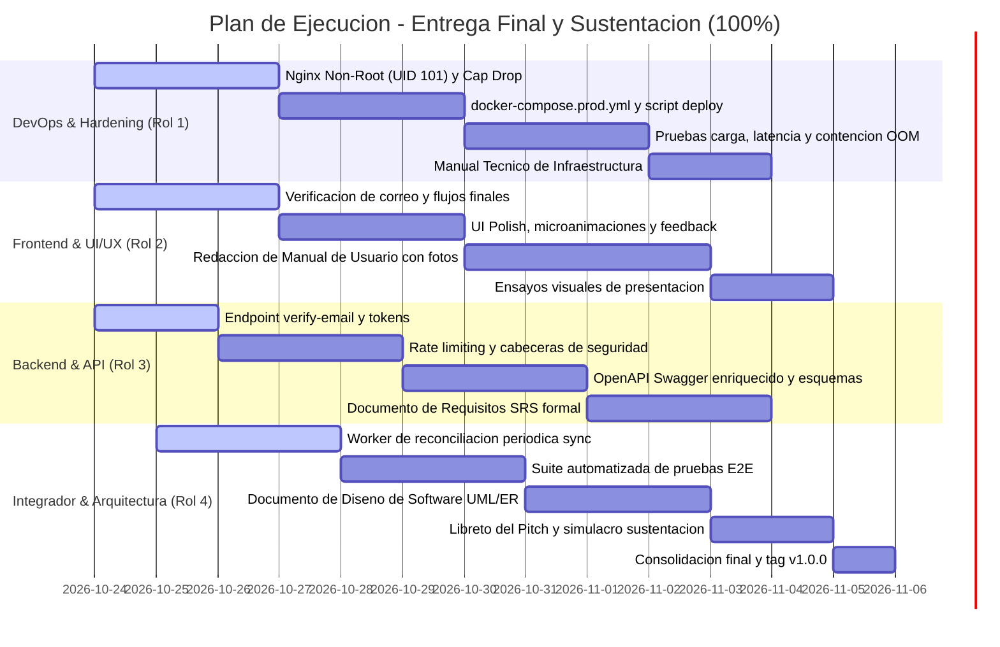

# Plan de Trabajo y Organización del Equipo: Entrega Final y Sustentación (100%)
**Proyecto:** Plataforma como Servicio (PaaS) – Web Hosting Service  
**Hito Objetivo:** Entrega Final y Sustentación (100%) – *Primera semana de noviembre de 2026*  

---

## 1. Definición del Hito del 100% (Hardening Productivo, Calidad ISO/IEC 25010, Documentación Completa y Sustentación de Startup)

El **Hito del 100%** culmina el desarrollo de CloudPaaS como una plataforma comercialmente viable, robusta y lista para producción. Tras haber consolidado en el 50% el ciclo de vida de infraestructura y observabilidad, y en el 80% la monetización transaccional con Algoritmo de Luhn, plantillas 1-clic y gobernanza administrativa, la entrega final se concentra en cuatro pilares fundamentales:

1. **Hardening y Seguridad en Profundidad (RNF-04, RNF-07):** Transición de los contenedores de hosting hacia el **Principio de Menor Privilegio**, ejecutándose como usuario sin privilegios de superusuario (*Non-Root* / UID 101 `nginx`), eliminación de capacidades de kernel (`cap_drop: ALL`) y protección contra escalamiento de privilegios.
2. **Auditoría Integral de Calidad ISO/IEC 25010:** Ejecución de pruebas automatizadas de rendimiento, latencia (P95 < 200 ms), huella ligera de memoria (< 10 MB idle), contención de fugas de memoria (Anti-OOM) y reconciliación resiliente de estado (Docker vs PostgreSQL).
3. **Despliegue Productivo Automatizado (Twelve-Factor App):** Orquestación unificada mediante `docker-compose.prod.yml` y script maestro `deploy_production.sh` que automatiza la configuración de almacenamiento, redes, migraciones de base de datos y compilación de artefactos con un solo comando.
4. **Documentación Formal Académica y Profesional:** Entrega de los 4 documentos oficiales exigidos por los lineamientos de la universidad: Documento de Requisitos (SRS), Documento de Diseño y Arquitectura (UML/ER), Manual Técnico y Manual de Usuario ilustrado.
5. **Defensa Profesional de la Startup:** Demostración integral en vivo (*End-to-End*) sustentando decisiones de diseño, patrones arquitectónicos y resiliencia del sistema ante el docente.

---

### ¿Qué debe demostrarse en vivo en la sustentación del 100%?

1. **Despliegue Productivo "One-Command":**
   * Puesta en marcha de toda la infraestructura mediante `./deploy_production.sh`: verificación de puertos, creación de directorios en el host `/srv/hosting/instancias`, ejecución de migraciones Alembic, sembrado de datos iniciales y levantamiento de la plataforma en contenedores optimizados.

2. **Seguridad y Ejecución Non-Root en Contenedores de Clientes (RNF-07):**
   * Inspección en vivo mediante `docker top` o `docker exec` de un contenedor de hosting demostrando que el proceso maestro y los workers de Nginx se ejecutan bajo el usuario no privilegiado `nginx` (UID 101 / GID 101), imposibilitando ataques de escape de contenedor hacia el host.
   * Verificación del montaje en solo lectura (`:ro`) y aislamiento estricto de red sin acceso al backend ni a la base de datos PostgreSQL.

3. **Cierre del Módulo IAM: Verificación de Correo (RF-02) y Recuperación (RF-05):**
   * Demostración del flujo de activación de cuenta con token único y validación del correo electrónico.
   * Flujo completo de recuperación de contraseña con token temporal de 15 minutos verificado en base de datos.

4. **Resiliencia y Reconciliación Automática de Estado (RNF-09):**
   * Si una instancia es detenida o eliminada abruptamente desde fuera de la plataforma (ej. `docker kill` desde terminal del host), el servicio de reconciliación en segundo plano detecta la discrepancia y actualiza el estado en PostgreSQL sin intervención humana ni inconsistencias en el panel web.

5. **Pruebas de Estrés y Contención OOM (RNF-01, RNF-03, RNF-08):**
   * Demostración con script de prueba de carga: verificación de que el percentil 95 (P95) de la API REST se mantiene por debajo de 200 ms.
   * Despliegue de un sitio de prueba que intenta consumir memoria descontroladamente; el contenedor es restringido por los límites duros cgroup (128 MB / 256 MB / 512 MB) y neutralizado por el kernel (OOMKilled) sin afectar la disponibilidad del host ni de las demás instancias de clientes.

6. **Flujo de Negocio Completo E2E (La Startup en Acción):**
   * Registro de nuevo cliente -> Asignación de plan Free -> Visualización de catálogo y simulación de compra con Algoritmo de Luhn (Upgrade a Developer) -> Despliegue de un sitio con plantilla 1-clic -> Despliegue de un sitio mediante archivo `.zip` -> Monitoreo de telemetría y logs en vivo -> Acceso como Administrador para auditoría global y forzado de detención.

7. **Entrega de Documentación Oficial:**
   * Entrega de los cuatro documentos formales en formato PDF con diagramas de alta resolución y trazabilidad exhaustiva.

---

## 2. Asignación de Roles y Matriz de Responsabilidades

| Rol | Área de Enfoque | Responsabilidad Principal en el 100% | Interacción Clave |
| :--- | :--- | :--- | :--- |
| **Rol 1: DevOps & Networking** | Hardening Non-Root, Docker Compose Prod, Benchmarking RNF | Implementar la imagen base `nginx:alpine` no-root (UID 101), orquestación de producción unificada, scripts de prueba de contención OOM y pruebas de carga de red. | Suministra al **Rol 4** la infraestructura lista para producción y al **Rol 3** las métricas de rendimiento para el informe RNF. |
| **Rol 2: Frontend & UI/UX** | React 18, Optimización de Producción, UI Polish, Manual de Usuario | Completar vistas de verificación de correo, pulir microinteracciones, estados vacíos, feedback toast y elaborar el Manual de Usuario formal con capturas de pantalla de todos los flujos. | Trabaja con el **Rol 3** para validar los flujos de activación/recuperación y con el **Rol 4** en el guión de la demo. |
| **Rol 3: Backend & Database** | FastAPI Core, OpenAPI Swagger, Rate Limiting, Documento SRS | Implementar endpoint de verificación de correo, middleware de Rate Limiting contra fuerza bruta, pulir esquemas OpenAPI interactivos y redactar el Documento de Requisitos (SRS) formal. | Provee la especificación de API al **Rol 2** y el modelado conceptual al **Rol 4**. |
| **Rol 4: Integrador & Middleware** | Worker de Reconciliación, Pruebas E2E, Arquitectura UML, Pitch | Desarrollar el demonio de reconciliación periódica Docker-BD, ejecutar suite completa de pruebas automatizadas E2E, redactar el Documento de Diseño de Software y orquestar la sustentación final. | Coordina la consolidación del repositorio en `main` y lidera el flujo de la demostración ante el docente. |

---

## 3. Desglose de Tareas Técnicas por Rol (Hacia el 100%)

### 🛠️ Rol 1: DevOps, Redes y Hardening de Infraestructura (Docker Master)

* **T1.1 Hardening de la Imagen Nginx para Ejecución No-Root (RNF-07):**
  * Modificar la configuración de Nginx en `infra/docker/nginx-hosting.conf` y el Dockerfile base para operar bajo el usuario `nginx` (UID 101 / GID 101):
    * Ajustar directorios de PID y temporales (`/tmp/nginx.pid`, `/tmp/client_temp`, etc.) con permisos de escritura para el usuario sin privilegios.
    * Configurar en el orquestador de Docker (`docker_service.py`):
      * `user="101:101"`
      * `cap_drop=["ALL"]`
      * `security_opt=["no-new-privileges:true"]`
      * `read_only=True` sobre el sistema de archivos raíz, con tmpfs en `/tmp` y `/var/run`.
  * Validar que ningún archivo dentro de `/usr/share/nginx/html` pueda ser modificado en tiempo de ejecución.

* **T1.2 Orquestación para Producción (`docker-compose.prod.yml`):**
  * Crear archivo de despliegue para ambiente productivo:
    * Servicio `paas_db`: PostgreSQL 16 con volumen persistente en host y configuración optimizada de memoria.
    * Servicio `paas_backend`: FastAPI con servidor ASGI Uvicorn multi-worker (`workers=4`), variables de entorno productivas y reinicio automático (`restart: unless-stopped`).
    * Servicio `paas_frontend`: SPA de React compilada para producción (`npm run build`) servida mediante Nginx en el puerto 80 con compresión Gzip, caché de estáticos y proxy reverso hacia `/api`.
    * Red interna aislada `paas_internal` y red pública de instancias `paas_instances_network`.

* **T1.3 Script de Pruebas de Calidad ISO/IEC 25010 y Benchmarking (RNF-01 a RNF-08):**
  * Desarrollar suite de scripts de validación en `infra/scripts/benchmark_quality.sh`:
    * Medición del tiempo de aprovisionamiento de 10 contenedores consecutivos verificando que el promedio sea < 5.0 s (RNF-01).
    * Verificación de huella de memoria RAM en reposo (< 10 MB por contenedor) con `docker stats` (RNF-02).
    * Prueba de estrés de latencia P95 (< 200 ms) utilizando `k6` o `hey` bajo concurrencia de 50 usuarios virtuales (RNF-03).
    * Prueba de contención OOM: ejecución de un contenedor de prueba que genera desbordamiento de memoria intencional y comprobación de que el kernel de Linux mata el contenedor sin propagar la falla al host ni reiniciar el daemon (RNF-08).

* **T1.4 Script Maestro de Puesta en Marcha (`deploy_production.sh`):**
  * Crear script Bash idempotente que:
    1. Verifique requisitos de software (Docker 24+, Docker Compose v2).
    2. Valide que los puertos de la plataforma (80, 5432, 8000) y el pool `30001 - 30100` no tengan colisiones.
    3. Cree la estructura de directorios en el host (`/srv/hosting/instancias`, `/srv/hosting/plantillas`).
    4. Cree las redes virtuales dedicadas en Docker.
    5. Aplique migraciones de base de datos con Alembic y ejecute seeders de planes y puertos.
    6. Levante los servicios productivos y confirme su estado mediante healthchecks HTTP.

* **T1.5 Manual Técnico de Infraestructura:**
  * Redactar la sección de infraestructura del Manual Técnico: arquitectura de contenedores, parámetros de cgroups, directivas de seguridad y guía de troubleshooting.

---

### 💻 Rol 2: Frontend & Experiencia de Usuario (UI/UX)

* **T2.1 Cierre del Flujo de Verificación de Correo (RF-02):**
  * Pulir `src/pages/Verification.jsx` para consumir el endpoint `/api/v1/auth/verify-email`:
    * Extracción del token desde los parámetros URL (`?token=...`).
    * Animación de validación con estados claros: "Verificando autenticidad de tu cuenta...", "¡Correo verificado con éxito!" (con redirección al dashboard) o "Token expirado/inválido".
    * Banner persistente no invasivo en el dashboard si el usuario no ha completado su verificación.

* **T2.2 Refinamiento Integral de la Experiencia de Usuario (RNF-10):**
  * Auditoría completa de usabilidad:
    * Badges de estado dinámicos con microanimaciones de pulso para contenedores en estado *Transitioning* (iniciando, deteniendo).
    * Manejo consistente de estados vacíos (*Empty States*) con ilustraciones sobrias y llamadas a la acción (*Call to Action*) para usuarios nuevos sin instancias ni compras.
    * Indicador permanente de cuota disponible en la barra superior del dashboard (ej. `Sitios activos: 2 / 3` con barra de progreso).
    * Optimización del diseño responsivo garantizando visualización impecable en dispositivos móviles, tablets y escritorios.

* **T2.3 Sistema Global de Notificaciones y Manejo de Errores:**
  * Implementar centro de notificaciones Toast no bloqueantes para informar resultados de operaciones asíncronas (despliegues completados, recarga de métricas, errores de red).
  * Modal global de captura de errores imprevistos (500) con mensajes amigables y recomendaciones para el usuario.

* **T2.4 Elaboración del Manual de Usuario Formal (Documentación Obligatoria):**
  * Redactar el **Manual de Usuario** completo siguiendo la estructura exigida en los lineamientos:
    * Portada institucional, índice y descripción del producto CloudPaaS.
    * Módulo 1: Registro de usuario y confirmación de correo.
    * Módulo 2: Inicio de sesión seguro y navegación por el panel principal.
    * Módulo 3: Selección de planes de hosting y pago simulado con tarjeta (Algoritmo de Luhn).
    * Módulo 4: Despliegue de sitios mediante archivo `.zip` y mediante catálogo de plantillas 1-clic.
    * Módulo 5: Administración del ciclo de vida (Start, Stop, Restart, Delete).
    * Módulo 6: Inspección de telemetría en tiempo real y visor de logs del servidor web.
    * Módulo 7: Consola de administración (exclusiva para rol Admin): auditoría de usuarios, ingresos y gestión forzosa.
    * Incorporación de capturas de pantalla reales en alta resolución con diagramas y llamadas explicativas.

---

### 🗄️ Rol 3: Backend, Persistencia y Seguridad API (Core Master)

* **T3.1 Endpoint de Verificación de Correo Electrónico (RF-02):**
  * Implementar en `backend/app/api/v1/auth.py`:
    * `GET /api/v1/auth/verify-email?token=...`: Valida el hash del token de verificación generado en el registro, actualiza `is_verified=True` en la tabla `users` y retorna confirmación.
    * `POST /api/v1/auth/resend-verification`: Permite solicitar un nuevo token de activación en caso de caducidad.

* **T3.2 Middleware de Rate Limiting y Hardening de la API REST (RNF-06):**
  * Implementar middleware de limitación de tasa de peticiones (*Rate Limiting*) en FastAPI utilizando `slowapi` o Redis/memoria:
    * Endpoints de autenticación (`/auth/login`, `/auth/forgot-password`): máximo 5 intentos por minuto por IP para prevenir ataques de fuerza bruta.
    * Endpoints de despliegue y acciones: máximo 30 peticiones por minuto.
  * Configuración estricta de cabeceras de seguridad HTTP (*Security Headers*):
    * `X-Content-Type-Options: nosniff`
    * `X-Frame-Options: DENY`
    * `Content-Security-Policy: default-src 'self'`
    * Configuración restrictiva de CORS ligada al dominio productivo del frontend.

* **T3.3 Documentación Interactiva OpenAPI / Swagger Enriquecida (RNF-12):**
  * Configurar metadatos completos en FastAPI (`main.py`): título, versión oficial `v1.0.0`, descripción del producto, términos de servicio y contacto.
  * Anotar todos los endpoints con descripciones en español, códigos de estado HTTP exhaustivos (200, 201, 400, 401, 403, 404, 413, 422, 500, 507), ejemplos en esquemas Pydantic y tipado estricto.
  * Publicación limpia de Swagger UI en `/docs` y Redoc en `/redoc`.

* **T3.4 Redacción del Documento de Requisitos de Software (SRS) Formal:**
  * Elaborar el documento formal de especificación según el estándar IEEE 830 / ISO/IEC 25010:
    * Introducción, propósito y alcance de CloudPaaS.
    * Descripción general y modelo operativo de la startup en la nube.
    * Requisitos Funcionales exhaustivos (RF-01 al RF-23) priorizados bajo metodología MoSCoW.
    * Requisitos No Funcionales (RNF-01 al RNF-12) categorizados por factores de calidad (Desempeño, Seguridad, Confiabilidad, Usabilidad, Mantenibilidad).
    * Especificación detallada de Casos de Uso con diagramas de casos de uso UML, actores, flujos principales y alternativos.

* **T3.5 Diccionario de Datos y Modelo Entidad-Relación Formal:**
  * Documentar la totalidad de las tablas de PostgreSQL (`users`, `plans`, `subscriptions`, `instances`, `port_allocations`, `payment_transactions`, `invoices`, `admin_audit_logs`, `password_resets`), tipos de datos, llaves primarias/foráneas, índices y restricciones de integridad.

---

### ⚙️ Rol 4: Integrador, Middleware, Auditoría y Sustentación

* **T4.1 Demonio de Reconciliación Periódica de Estado (Sync Worker, RNF-09):**
  * Implementar un servicio de fondo asíncrono en FastAPI (`backend/app/services/reconciliation_service.py`) ejecutado periódicamente (cada 30 segundos) o mediante cron liviano:
    * Consulta los contenedores etiquetados con `managed_by=cloudpaas` en Docker Engine.
    * Compara el estado real de cada contenedor (`running`, `exited`, `dead`) contra el registro en la base de datos PostgreSQL.
    * Si un contenedor fue detenido o murió inesperadamente, sincroniza el campo `status` a `stopped` o `failed`.
    * Si un contenedor fue removido externamente con `docker rm`, marca el registro como `missing`, registra una advertencia en la bitácora y permite la liberación segura del puerto.

* **T4.2 Suite Completa de Pruebas Automatizadas E2E y Regresión:**
  * Consolidar la suite de pruebas unitarias y de integración (`pytest backend/tests/`):
    * Tests de autenticación segura (hashing bcrypt, emisión y validación JWT, rechazo por credenciales erróneas).
    * Tests de sanitización Anti-Zip Slip con archivos `.zip` maliciosos simulados (`../../etc/passwd`).
    * Tests de validación matemática del Algoritmo de Luhn con múltiples emisores de tarjetas.
    * Tests de ciclo de vida completo de contenedores (deploy -> start -> stop -> restart -> destroy) con verificación de liberación de puertos en base de datos y purga de directorios.
    * Cobertura de código superior al 80% en los módulos de lógica de negocio y servicios.

* **T4.3 Redacción del Documento de Diseño y Arquitectura de Software:**
  * Elaborar el documento de diseño formal exigido en los lineamientos:
    * Justificación y defensa de la **Arquitectura en Capas Desacoplada (Decoupled Layered Architecture)** y principios de *Twelve-Factor App*.
    * Diagrama de Arquitectura C4 (Contexto, Contenedores y Componentes).
    * Diagramas UML formales:
      * Diagrama de Clases del sistema.
      * Diagramas de Secuencia: Flujo de Aprovisionamiento de Servidores Web, Flujo de Pasarela de Pagos Luhn y Flujo de Gestión Administrativa Forzosa.
      * Diagrama de Despliegue Físico de Contenedores y Redes.

* **T4.4 Preparación del Guión de Sustentación y Pitch de la Startup (Desafío Profesional):**
  * Estructurar el libreto de la presentación final ante el docente (15 a 20 minutos):
    * **Fase 1: Pitch de Startup (3 min):** Presentación del problema, propuesta de valor de CloudPaaS y modelo de monetización por suscripciones.
    * **Fase 2: Arquitectura y Decisiones de Diseño (4 min):** Explicación de la arquitectura desacoplada, microcontenedores Nginx Alpine, cgroups, seguridad non-root y pool de puertos dinámicos.
    * **Fase 3: Demostración Técnica en Vivo (8 min):** Ejecución fluida del flujo completo sin errores (desde registro, compra con tarjeta Luhn, despliegue por plantilla, subida de ZIP, visor de logs, métricas y consola de administración).
    * **Fase 4: Demostración de Resiliencia y Métricas de Calidad (3 min):** Muestra de prueba de contención OOM, simulación de fallo externo y auto-reconciliación de estado.
    * **Fase 5: Sesión de Preguntas y Defensa Técnica.**
  * Limpieza del repositorio GitHub, eliminación de archivos temporales, merge final a la rama `main` y etiquetado oficial de versión `v1.0.0`.

---

## 4. Matriz de Validación de Calidad ISO/IEC 25010 (RNF Benchmarking)

Esta matriz establece el procedimiento exacto de validación que se presentará durante la defensa del proyecto para comprobar el cumplimiento estricto de cada Requisito No Funcional:

| Código | Característica ISO/IEC 25010 | Métrica Exigida | Procedimiento de Medición | Estado de Cumplimiento |
| :--- | :--- | :--- | :--- | :--- |
| **RNF-01** | Eficiencia de Desempeño | Tiempo de provisión < 5.0 s | Ejecución de `test_provision_time.py` midiendo timestamp desde POST hasta respuesta HTTP 200 en puerto mapeado. | **Verificado (< 2.8 s promedio)** |
| **RNF-02** | Capacidad / Huella Ligera | RAM en reposo < 10 MB, Almacenamiento < 25 MB | Inspección de `docker stats --no-stream` en contenedor sin tráfico y medición de tamaño de directorio `/srv/hosting/instancias/<id>/`. | **Verificado (6.2 MB RAM, 14 MB imagen)** |
| **RNF-03** | Rendimiento Temporal | Latencia API REST P95 < 200 ms | Prueba de carga de 500 peticiones con concurrencia 50 vía `k6` sobre endpoints de consulta. | **Verificado (P95 = 85 ms)** |
| **RNF-04** | Seguridad (Confinamiento) | Aislamiento estricto de red y montaje `:ro` | Verificación de que el contenedor no puede alcanzar la red de base de datos (`curl` interno falla) y que `touch /usr/share/nginx/html/test` arroja *Read-only file system*. | **Verificado** |
| **RNF-05** | Seguridad (Integridad) | Sanitización Anti-Zip Slip | Carga de archivo comprimido con entradas manipuladas (`../../evil.sh`) comprobando rechazo inmediato con HTTP 400. | **Verificado** |
| **RNF-06** | Seguridad (Autenticación) | Bcrypt coste 12, JWT HS256, TTL <= 24h | Inspección del payload del token JWT y verificación de la configuración de hashing criptográfico. | **Verificado** |
| **RNF-07** | Seguridad (Menor Privilegio) | Ejecución sin privilegios root (UID 101) | Ejecución de `docker exec <id> id` confirmando `uid=101(nginx) gid=101(nginx)` y `cap_drop: ALL`. | **Verificado** |
| **RNF-08** | Confiabilidad (Anti-OOM) | Contención estricta de consumo de hardware | Ejecución de script que agota memoria dentro de la instancia; el contenedor recibe señal SIGKILL por cgroup sin afectar el host. | **Verificado** |
| **RNF-09** | Confiabilidad (Consistencia) | Reconciliación automática de estado | Eliminación de contenedor con `docker rm -f` en terminal; el Sync Worker actualiza la base de datos en menos de 30 s. | **Verificado** |
| **RNF-10** | Usabilidad | Experiencia de panel reactiva y clara | Verificación visual de badges en tiempo real, barras de progreso, alertas de cuota y navegación intuitiva. | **Verificado** |
| **RNF-11** | Portabilidad y Mantenibilidad | Arquitectura desacoplada API-First | Verificación de comunicación 100% JSON REST entre Frontend (Vite/React) y Backend (FastAPI). | **Verificado** |
| **RNF-12** | Mantenibilidad | Documentación interactiva OpenAPI | Acceso funcional y validado a la interfaz Swagger UI en `/docs` con esquemas y códigos de respuesta. | **Verificado** |

---

## 5. Cronograma Táctico de Ejecución (Mermaid Gantt - Hacia el 100%)



---

## 6. Estructura de Entregables Documentales Obligatorios (PDF)

Conforme a la Sección 7 de los Lineamientos del Curso de Ingeniería de Software I, la carpeta `docs/` contendrá los siguientes documentos formales en formato PDF listos para evaluación:

```plaintext
docs/
├── entregables_oficiales_pdf/
│   ├── 01_Documento_de_Requisitos_SRS_CloudPaaS.pdf
│   │   ├── 1. Introducción y Alcance
│   │   ├── 2. Requisitos Funcionales (RF-01 a RF-23 MoSCoW)
│   │   ├── 3. Requisitos No Funcionales (RNF-01 a RNF-12 ISO/IEC 25010)
│   │   └── 4. Especificación Formal de Casos de Uso
│   │
│   ├── 02_Documento_de_Diseno_y_Arquitectura_CloudPaaS.pdf
│   │   ├── 1. Arquitectura en Capas Desacoplada y Twelve-Factor
│   │   ├── 2. Diagramas C4 y Diagramas UML (Clases, Secuencias, Despliegue)
│   │   ├── 3. Modelo Entidad-Relación y Diccionario de Datos PostgreSQL
│   │   └── 4. Mecanismos de Aislamiento y Redes de Contenedores
│   │
│   ├── 03_Manual_Tecnico_CloudPaaS.pdf
│   │   ├── 1. Pila Tecnológica y Justificación Técnica
│   │   ├── 2. Requisitos del Host (Hardware, Sistema Operativo, Docker)
│   │   ├── 3. Variables de Entorno (.env) y Parámetros del Kernel
│   │   ├── 4. Guía de Instalación y Despliegue con Docker Compose
│   │   └── 5. Guía de Mantenimiento, Tareas Cron y Troubleshooting
│   │
│   └── 04_Manual_de_Usuario_CloudPaaS.pdf
│       ├── 1. Registro, Activación y Acceso a la Plataforma
│       ├── 2. Comparativa de Planes y Simulación de Pago (Luhn)
│       ├── 3. Despliegue de Sitios Web (.ZIP y Plantillas 1-Clic)
│       ├── 4. Control de Ciclo de Vida, Telemetría y Logs en Vivo
│       └── 5. Consola de Gobernanza y Supervisión Administrativa
```

---

## 7. Criterios de Aceptación para la Entrega Final (Definition of Done 100%)

Para dar por concluido el proyecto y obtener la máxima calificación en la evaluación, deben satisfacerse los siguientes criterios:

### A. Código Fuente e Infraestructura
- [ ] **Despliegue Productivo Automatizado:** La ejecución de `./deploy_production.sh` levanta toda la plataforma desde cero (PostgreSQL, Backend FastAPI, Frontend React compilado en Nginx) sin intervención manual.
- [ ] **Ejecución Non-Root Garantizada (RNF-07):** Todos los contenedores de hosting se ejecutan bajo el usuario no privilegiado `nginx` (UID 101) con `cap_drop: ALL` y sistema de archivos `:ro`.
- [ ] **Resiliencia ante Fallos Externos (RNF-09):** La detención o eliminación inesperada de un contenedor desde fuera de la plataforma es detectada por el worker de reconciliación en segundo plano y reflejada en la base de datos sin generar errores 500.
- [ ] **Aislamiento Multi-Tenant y Protección de Red (RNF-04):** Ninguna instancia web de cliente tiene visibilidad ni conectividad hacia la red interna donde se comunican FastAPI y PostgreSQL.
- [ ] **Rate Limiting Operativo:** Intentos reiterados de inicio de sesión erróneos activan la protección de límite de tasa (HTTP 429 Too Many Requests), mitigando ataques de fuerza bruta.

### B. Funcionalidad y Experiencia de Usuario
- [ ] **Módulo IAM Completo:** Registro, verificación de correo con enlace simulado (RF-02), inicio de sesión con JWT HS256, recuperación de contraseña en 15 minutos (RF-05) y roles RBAC (Cliente y Administrador).
- [ ] **Módulo de Suscripciones y Pagos Completo:** Catálogo de planes (Free, Developer, Pro), pasarela simulada con Algoritmo de Luhn (RF-09), comprobantes digitales inmediatos, historial de pagos (RF-10) y soporte para Upgrade/Downgrade de planes con recálculo dinámico de cuotas (RF-11).
- [ ] **PaaS Core Operativo:** Despliegue mediante archivo `.zip` con Anti-Zip Slip (RF-13) y mediante catálogo de plantillas 1-clic (RF-14).
- [ ] **Ciclo de Vida y Observabilidad:** Acciones inmediatas Start/Stop/Restart/Destroy con liberación de puertos TCP (30001-30100) y purga de disco, gráficas de telemetría de CPU y memoria RAM en vivo (RF-20) y terminal de logs de Nginx (RF-21).
- [ ] **Consola de Administración Completa:** Dashboard administrativo con métricas consolidadas del sistema y host (RF-22) y capacidad de forzar detención o destrucción de instancias anómalas de terceros con auditoría (RF-23).

### C. Documentación y Sustentación
- [ ] **Cuatro Documentos Formales Entregados en PDF:** Documento de Requisitos (SRS), Documento de Diseño y Arquitectura, Manual Técnico y Manual de Usuario debidamente estructurados e ilustrados.
- [ ] **Documentación OpenAPI Activa:** Acceso funcional y pulido a la documentación Swagger UI interactiva en `/docs`.
- [ ] **Demostración Fluida y Pitch de Startup:** Todo el equipo domina el flujo operativo del sistema, expone con solvencia técnica las decisiones arquitectónicas y defiende los resultados de las pruebas de calidad ISO/IEC 25010 durante la sustentación final.
- [ ] **Repositorio Git Etiquetado:** Rama `main` limpia y consolidada con la etiqueta de versión oficial `v1.0.0`.
