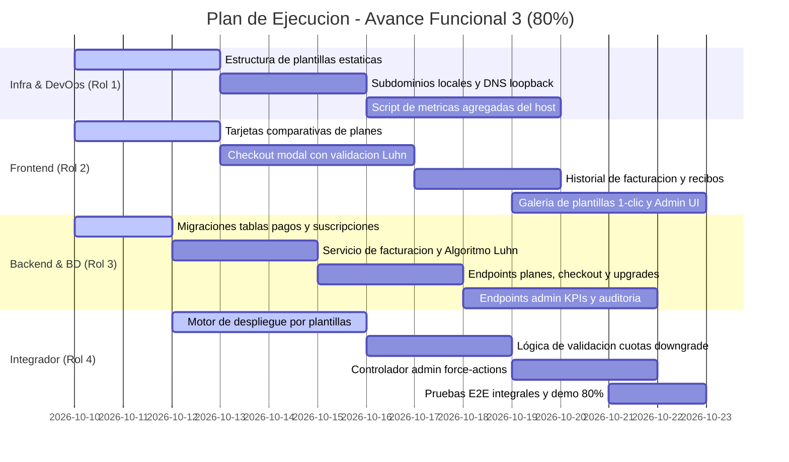

# Plan de Trabajo y Organización del Equipo: Avance Funcional 3 (80%)
**Proyecto:** Plataforma como Servicio (PaaS) – Web Hosting Service  
**Hito Objetivo:** Avance Funcional 3 (80%) – *23 de octubre de 2026*  

---

## 1. Definición del Hito del 80% (Monetización, Suscripciones, Plantillas 1-Clic y Gobernanza Administrativa)

Tras haber consolidado con éxito en el Hito del 50% el motor central de aprovisionamiento de contenedores (`nginx:alpine`), el ciclo de vida interactivo (*Start*, *Stop*, *Restart*, *Destroy*), el saneamiento *Anti-Zip Slip*, la telemetría de CPU/RAM y el visor de logs en tiempo real, el **Hito del 80%** representa la transformación de la plataforma en un modelo de negocio de **Startup Tecnológica en la Nube**.

En este avance se introducen los componentes de monetización transaccional mediante pasarela simulada con validación matemática (Algoritmo de Luhn), el catálogo de planes parametrizados con políticas de cambio de suscripción (*Upgrade/Downgrade*), el aprovisionamiento instantáneo mediante plantillas prediseñadas en 1 clic y la consola central de gobernanza y supervisión global exclusiva para el rol Administrador.

---

### ¿Qué debe demostrarse en vivo en la entrega del 80%?

1. **Catálogo y Contratación de Suscripciones (RF-07, RF-08):**
   * Vista comparativa interactiva de los tres planes comerciales (*Free*, *Developer*, *Pro*), exhibiendo con total claridad: precio mensual simulado, vigencia y cuotas técnicas asignadas (número máximo de sitios simultáneos, memoria RAM tope por contenedor y porcentaje de CPU dedicado).
   * Al registrarse, todo usuario adquiere automáticamente el plan *Free* (1 sitio, 128 MB RAM, 0.25 vCPU).

2. **Pasarela de Pagos Simulada con Algoritmo de Luhn (RF-09):**
   * Formulario modal de pago que captura: número de tarjeta (16 dígitos), fecha de expiración (MM/AA), código de seguridad (CVV de 3 dígitos) y nombre del titular.
   * **Validación matemática en tiempo real:** Verificación estricta mediante el **Algoritmo de Luhn (Módulo 10)** tanto en el cliente (retroalimentación instantánea) como en el backend antes de persistir la transacción. Tarjetas con suma no congruente o fechas vencidas son rechazadas con mensaje explicativo.
   * Generación de comprobante digital inmediato con identificador único de transacción, código de autorización simulado (`AUTH-XXXXXX`), fecha/hora y estado `Aprobada`.

3. **Historial Transaccional Inmutable y Recibos (RF-10):**
   * Panel de facturación donde el cliente consulta la bitácora cronológica de todos sus pagos, con desglose del monto, concepto, código de autorización y visualización de comprobante digital.

4. **Gestión Dinámica de Suscripciones: Upgrade y Downgrade (RF-11):**
   * **Upgrade:** El cliente sube a un plan superior (ej. *Free* a *Developer* o *Pro*); el backend recalcula inmediatamente la cuota en su perfil y le permite desplegar nuevas instancias de forma instantánea.
   * **Downgrade:** Si un cliente solicita bajar de plan (ej. *Pro* a *Developer*) y posee más instancias activas de las que admite la nueva cuota, el sistema bloquea preventivamente la operación solicitándole detener o eliminar las instancias excedentes antes de formalizar el cambio.

5. **Aprovisionamiento Inmediato por Plantillas Rápidas 1-Clic (RF-14):**
   * Catálogo de sitios preconfigurados listos para producción (*Landing Page Moderna*, *Portafolio de Desarrollador*, *Plantilla HTML5 / Documentación*).
   * Despliegue en 1 clic sin necesidad de que el usuario empaquete o cargue un `.zip`: el backend clona la plantilla desde el repositorio interno del host hacia `/srv/hosting/instancias/<user_id>_<app_id>/`, asigna puerto del pool dinámico `30001 - 30100` y levanta el contenedor Nginx en menos de 5 segundos.

6. **Panel de Gobernanza y Supervisión Global para Administradores (RF-06, RF-22, RF-23):**
   * Autenticación con rol `admin` protegida por RBAC que otorga acceso a la ruta `/admin`.
   * **Métricas Consolidadas de Plataforma:** Total de usuarios activos, ingresos simulados acumulados (MRR), total de contenedores en ejecución en el host y consumo global agregado de CPU y RAM del servidor.
   * **Auditoría y Gestión Forzosa:** Tabla global de todas las instancias del sistema con opción de **Forzar Detención (*Force Stop*)** o **Forzar Eliminación (*Force Destroy*)** de instancias anómalas de cualquier inquilino, liberando puertos y purgando el almacenamiento con registro estricto en bitácora de auditoría.

7. **Recuperación Segura de Contraseña (RF-05):**
   * Flujo de restablecimiento de contraseña mediante token de un solo uso con caducidad estricta de 15 minutos, simulado en entorno local.

---

> [!NOTE]
> **Alcance del Hito del 80%:**
> * Pasarela de pago simulada con Algoritmo de Luhn (RF-09).
> * Catálogo comercial de planes, contratación, historial y comprobantes digitales (RF-07, RF-08, RF-10).
> * Política transaccional de Upgrade y Downgrade con control estricto de cuotas (RF-11).
> * Despliegue de sitios en 1 clic a partir de plantillas estáticas (RF-14).
> * Consola de gobernanza y supervisión global para rol Administrador (RF-06, RF-22, RF-23).
> * Flujo de recuperación de contraseñas con token de 15 min (RF-05).
>
> **Lo que se reserva para el Hito Final del 100%:**
> * Hardening de seguridad con contenedores Nginx en modo *Non-Root* (UID 101, RNF-07) y `cap_drop: ALL`.
> * Verificación formal de correo electrónico (RF-02).
> * Demonio de reconciliación periódica continua en background (RNF-09).
> * Orquestación de producción unificada `docker-compose.prod.yml` y script maestro `deploy_production.sh`.
> * Suite de pruebas de estrés y latencia P95 < 200ms (RNF-01, RNF-02, RNF-03, RNF-08).
> * Cuatro documentos formales obligatorios (SRS, Diseño de Arquitectura UML/ER, Manual Técnico y Manual de Usuario).
> * Preparación del Pitch de la Startup y Sustentación Final.

---

## 2. Asignación de Roles y Matriz de Responsabilidades

| Rol | Área de Enfoque | Responsabilidad Principal en el 80% | Interacción Clave |
| :--- | :--- | :--- | :--- |
| **Rol 1: DevOps & Networking** | Plantillas Base, Host Metrics, Subdominios Locales | Preparar el catálogo de plantillas estáticas en el filesystem, configurar resolución de subdominios locales (`*.localhost`), y extraer métricas agregadas del host para el panel de administración. | Provee al **Rol 4** las plantillas listas en disco y al **Rol 3** los datos del daemon para las métricas del host. |
| **Rol 2: Frontend & UI/UX** | React 18, Tailwind CSS, Vistas de Negocio y Admin | Desarrollar la interfaz del catálogo de planes, modal de pago interactivo con validación visual Luhn, selector de plantillas 1-clic, vista de facturación y panel de administración global. | Consume los endpoints de facturación, plantillas y administración desarrollados por los **Roles 3 y 4**. |
| **Rol 3: Backend & Database** | FastAPI Core, PostgreSQL, Modelos de Facturación, RBAC | Crear tablas y modelos relacionales de pagos, facturas y suscripciones; implementar el Algoritmo de Luhn en `BillingService`; exponer endpoints `/billing/*`, `/admin/*` y `/auth/forgot-password`. | Provee los modelos de datos y endpoints de facturación al **Rol 4** y los contratos JSON al **Rol 2**. |
| **Rol 4: Integrador & Middleware** | Docker SDK, File System, Plantillas Engine, Middleware RBAC | Desarrollar el servicio de clonación y despliegue de plantillas (`template_service.py`), lógica de control de cuotas en upgrade/downgrade y endpoints de acciones forzosas del administrador. | Conecta el almacenamiento de plantillas del **Rol 1** con la lógica de negocio del **Rol 3** y las vistas del **Rol 2**. |

---

## 3. Desglose de Tareas Técnicas por Rol (Hacia el 80%)

### 🛠️ Rol 1: DevOps, Redes y Contenedores (Docker Master)

* **T1.1 Creación y Estructura del Catálogo de Plantillas Base (RF-14):**
  * Diseñar y empaquetar tres plantillas estáticas optimizadas en `/srv/hosting/plantillas/`:
    * `landing-business/`: Landing page moderna responsiva con HTML5, Tailwind CSS embebido e imágenes optimizadas (tamaño total < 1.5 MB).
    * `personal-portfolio/`: Portafolio minimalista para desarrollador con secciones de proyectos, habilidades y contacto.
    * `html5-docs/`: Estructura limpia para documentación técnica con barra de navegación lateral y estilos claros.
  * Validar que los archivos posean permisos de lectura adecuados (`chmod -R 755`) para que Nginx pueda servirlos sin errores de permisos al ser clonados.

* **T1.2 Soporte para Subdominios Locales Simulados (RF-19, RNF-04):**
  * Configurar las directivas de cabeceras en Nginx para soportar el formato `http://<subdominio>.localhost:PUERTO`, garantizando que resuelva nativamente a `127.0.0.1` en navegadores modernos (Chrome, Firefox, Edge) sin requerir modificaciones en el archivo `/etc/hosts`.

* **T1.3 Extracción de Métricas Consolidadas del Host para Administradores (RF-22):**
  * Desarrollar script o utilidad en Python/Bash (`infra/scripts/get_host_metrics.py`) que recolecte:
    * Porcentaje de uso total de CPU del host (vía `psutil` o `/proc/stat`).
    * Memoria RAM total, usada y libre en el host (`psutil.virtual_memory()`).
    * Espacio total y disponible en la partición donde reside `/srv/hosting/`.
    * Total de contenedores Docker activos, pausados y detenidos en el host (`docker info`).

* **T1.4 Políticas de Seguridad en Directorio de Plantillas:**
  * Configurar el directorio `/srv/hosting/plantillas/` con atributo de solo lectura para los procesos de ejecución, asegurando que ninguna operación de usuario o contenedor pueda sobreescribir las plantillas maestras.

---

### 💻 Rol 2: Frontend & Experiencia de Usuario (UI/UX)

* **T2.1 Comparador Visual de Planes y Precios (RF-07, RF-08):**
  * Crear la vista `src/pages/PricingPage.jsx` con tarjetas interactivas para los planes *Free*, *Developer* y *Pro*:
    * Indicadores visuales de cuotas: límite de sitios, RAM máx por contenedor, cuota de CPU.
    * Badge distintivo de **"Plan Actual"** en el plan que tenga contratado el usuario.
    * Botón dinámico: **"Plan Activo"** (deshabilitado), **"Mejorar Plan (Upgrade)"** o **"Cambiar Plan (Downgrade)"**.

* **T2.2 Pasarela de Pagos Simulada con Algoritmo de Luhn en Vivo (RF-09):**
  * Crear el componente `src/components/billing/CheckoutModal.jsx`:
    * Tarjeta de crédito interactiva que se anima y muestra el emisor detectado (*Visa*, *Mastercard*, *Amex*) según los primeros dígitos.
    * Formateo automático de espacios cada 4 dígitos (`XXXX XXXX XXXX XXXX`).
    * Validación inmediata del **Algoritmo de Luhn** en el evento `onChange`: borde verde si el checksum es válido, rojo si es inválido.
    * Campos para fecha de vencimiento (`MM/AA`), código CVV (3 o 4 dígitos) y nombre del titular.
    * Spinner de confirmación de pago ("Validando con entidad bancaria simulada...", "¡Transacción Aprobada!").

* **T2.3 Historial de Facturación y Comprobantes Digitales (RF-10):**
  * Crear la vista `src/pages/BillingHistoryPage.jsx`:
    * Tabla con el historial de compras: Fecha, ID de Factura, Plan, Monto, Código de Autorización y Estado (`Aprobada`).
    * Modal de Comprobante Digital (`src/components/billing/ReceiptModal.jsx`) con diseño tipo factura electrónica imprimible/descargable.

* **T2.4 Integración de Plantillas en el Modal de Despliegue (RF-14):**
  * Extender `src/components/instances/DeployModal.jsx` con pestañas de selección:
    * **Pestaña 1: "Subir archivo .ZIP"** (flujo existente del 50%).
    * **Pestaña 2: "Plantillas en 1 Clic"**: Galería de tarjetas visuales con miniaturas de las 3 plantillas disponibles (*Landing Page*, *Portafolio*, *Documentación*), botón de "Vista Previa" y botón "Desplegar Plantilla".

* **T2.5 Panel de Gobernanza Administrativa (RF-22, RF-23):**
  * Crear la vista protegida `src/pages/AdminDashboardPage.jsx`:
    * Tarjetas KPI en la cabecera: Total Usuarios, Ingresos Totales Simulados ($), Contenedores Activos, Carga CPU Host (%), Uso RAM Host (%).
    * Tabla global de instancias de todos los usuarios: ID, Nombre, Propietario (Email), Puerto, Estado, Consumo de RAM y CPU.
    * Botones de acción administrativa de emergencia: **"Forzar Detención"** y **"Forzar Eliminación"** con modal de doble confirmación.
    * Tabla de usuarios registrados con visualización de plan actual y fecha de registro.

* **T2.6 Flujo de Recuperación de Contraseña (RF-05):**
  * Crear `src/pages/ForgotPassword.jsx` (ingreso de correo) y `src/pages/ResetPassword.jsx` (ingreso de nueva contraseña con token de 15 minutos).

---

### 🗄️ Rol 3: Backend & Arquitectura de Base de Datos

* **T3.1 Modelado Relacional para Suscripciones, Pagos y Auditoría (PostgreSQL):**
  * Diseñar y aplicar migraciones de Alembic para las nuevas entidades:
    * `Plan`: Actualizar campos (`max_instances`, `max_ram_mb`, `cpu_quota`, `price`, `description`).
    * `Subscription`: `id`, `user_id`, `plan_id`, `status` (*active*, *cancelled*), `current_period_start`, `current_period_end`.
    * `PaymentTransaction`: `id`, `user_id`, `plan_id`, `amount`, `card_last_four`, `card_brand`, `auth_code`, `status` (*approved*, *rejected*), `created_at`.
    * `Invoice`: `id`, `transaction_id`, `user_id`, `invoice_number` (`INV-2026-XXXX`), `amount`, `tax`, `pdf_metadata`, `created_at`.
    * `PasswordResetToken`: `id`, `user_id`, `token_hash`, `expires_at`, `used`.
    * `AdminAuditLog`: `id`, `admin_user_id`, `target_instance_id`, `action`, `details`, `timestamp`.

* **T3.2 Servicio de Facturación y Validación Algoritmo de Luhn (`BillingService`):**
  * Crear `backend/app/services/billing_service.py`:
    * Implementación matemática del **Algoritmo de Luhn** para validar la integridad del número de tarjeta de 16 dígitos:
      ```python
      def validate_luhn(card_number: str) -> bool:
          digits = [int(d) for d in card_number.replace(" ", "") if d.isdigit()]
          if len(digits) < 13 or len(digits) > 19:
              return False
          checksum = 0
          reverse_digits = digits[::-1]
          for i, digit in enumerate(reverse_digits):
              if i % 2 == 1:
                  doubled = digit * 2
                  checksum += doubled - 9 if doubled > 9 else doubled
              else:
                  checksum += digit
          return checksum % 10 == 0
      ```
    * Detección de marca de tarjeta (*Visa*, *Mastercard*, *Amex*) mediante patrones de prefijos.
    * Validación de fecha de expiración (`exp_month`, `exp_year`) garantizando que no esté en el pasado.
    * Generación de código de autorización pseudoaleatorio criptográfico (`AUTH-` + 6 caracteres alfanuméricos).
    * Registro atómico en base de datos de `PaymentTransaction` y emisión de `Invoice`.

* **T3.3 Endpoints de Suscripciones y Pagos en FastAPI:**
  * `GET /api/v1/plans`: Retorna el catálogo público de planes parametrizados.
  * `POST /api/v1/billing/checkout`: Recibe datos de tarjeta simulada y plan objetivo; valida Luhn, procesa la transacción y actualiza la suscripción.
  * `GET /api/v1/billing/invoices`: Lista el historial de transacciones y facturas del usuario autenticado.
  * `POST /api/v1/subscriptions/change-plan`: Maneja la solicitud de Upgrade o Downgrade de plan con validación de cuotas.

* **T3.4 Endpoints de Supervisión Global y Auditoría (`/api/v1/admin/*`):**
  * Middleware de autorización `require_admin` que valida el rol en el token JWT (HTTP 403 si no es `admin`).
  * `GET /api/v1/admin/dashboard`: Retorna KPIs globales del sistema (usuarios, facturación acumulada, contenedores y métricas del host).
  * `GET /api/v1/admin/instances`: Retorna listado completo de todas las instancias del sistema con datos de su propietario.
  * `POST /api/v1/admin/instances/{id}/force-action`: Ejecuta detención o eliminación forzada sobre cualquier instancia, registrando la operación en `AdminAuditLog`.

* **T3.5 Endpoints de Recuperación de Contraseña (RF-05):**
  * `POST /api/v1/auth/forgot-password`: Genera token de restablecimiento de 15 minutos de caducidad.
  * `POST /api/v1/auth/reset-password`: Valida token no expirado ni usado y actualiza el `password_hash` del usuario.

---

### ⚙️ Rol 4: Integrador, Middleware & Orquestación Docker

* **T4.1 Módulo de Aprovisionamiento por Plantillas (`TemplateService`):**
  * Crear `backend/app/services/template_service.py`:
    * Definir catálogo interno de plantillas disponibles con sus metadatos (nombre, descripción, ruta origen en `/srv/hosting/plantillas/`).
    * Endpoint `POST /api/v1/instances/deploy-template`:
      1. Valida que el usuario tenga cuota de instancias disponible según su plan activo.
      2. Asigna un puerto libre del pool dinámico `30001 - 30100`.
      3. Crea el directorio de destino `/srv/hosting/instancias/<user_id>_<app_id>/`.
      4. Realiza una copia recursiva rápida y segura desde el directorio de la plantilla elegida.
      5. Invoca a `DockerService.create_container` configurando el montaje `:ro`, límites cgroup de CPU/RAM y mapeo de puertos.
      6. Registra la instancia en PostgreSQL y retorna la URL directa de acceso.

* **T4.2 Interceptor de Control de Cuotas en Upgrade / Downgrade:**
  * Desarrollar la lógica de negocio para validar cambios de suscripción:
    * En caso de **Upgrade**, actualizar inmediatamente los límites del usuario.
    * En caso de **Downgrade**, contar las instancias activas (`status != 'destroyed'`). Si el conteo supera el `max_instances` del nuevo plan solicitado, rechazar la operación con HTTP 400 y detallar cuántas instancias debe dar de baja el usuario.

* **T4.3 Orquestación de Acciones Administrativas de Emergencia:**
  * Implementar en `backend/app/services/admin_service.py` los métodos para que el administrador pueda intervenir contenedores de terceros:
    * `force_stop_instance(instance_id)`: Detiene el contenedor en Docker Engine y actualiza el estado a `stopped`.
    * `force_destroy_instance(instance_id)`: Remueve el contenedor de Docker, libera el puerto en `port_allocations` y purga los archivos del host en `storage_path`, garantizando que la cuota del cliente se sincronice.

* **T4.4 Pruebas de Integración E2E del Flujo Completo:**
  * Desarrollar suite de pruebas automatizadas en `backend/tests/test_flow_80.py`:
    * Test de validación y rechazo del Algoritmo de Luhn con tarjetas de prueba estándar (ej. `4111 1111 1111 1111` válida vs tarjeta con dígito de verificación corrupto).
    * Test de aprovisionamiento de instancia a partir de plantilla en menos de 5 segundos.
    * Test de verificación de permisos administrativos (bloqueo a clientes comunes, acceso permitido a admins).

---

## 4. Contrato de Integración Clave (API Interface para el 80%)

### 4.1 `GET /api/v1/plans`
* **Acceso:** Público (o autenticado)
* **Respuesta HTTP 200:**
```json
[
  {
    "id": 1,
    "name": "Free",
    "description": "Ideal para prototipos y pruebas personales",
    "price": 0.00,
    "max_instances": 1,
    "max_ram_mb": 128,
    "cpu_quota": 0.25,
    "is_active": true
  },
  {
    "id": 2,
    "name": "Developer",
    "description": "Para desarrolladores con múltiples sitios activos",
    "price": 9.99,
    "max_instances": 3,
    "max_ram_mb": 256,
    "cpu_quota": 0.50,
    "is_active": true
  },
  {
    "id": 3,
    "name": "Pro",
    "description": "Máxima potencia para sitios web de alto tráfico",
    "price": 24.99,
    "max_instances": 10,
    "max_ram_mb": 512,
    "cpu_quota": 1.00,
    "is_active": true
  }
]
```

---

### 4.2 `POST /api/v1/billing/checkout`
* **Headers:** `Authorization: Bearer <token>`, `Content-Type: application/json`
* **Body:**
```json
{
  "plan_id": 2,
  "card_holder": "USUARIO PRUEBA",
  "card_number": "4532015112830366",
  "exp_month": 12,
  "exp_year": 2028,
  "cvv": "123"
}
```
* **Respuesta HTTP 200 (Transacción Exitosa):**
```json
{
  "transaction_id": 1042,
  "status": "approved",
  "auth_code": "AUTH-7F9B2C",
  "plan_name": "Developer",
  "amount_charged": 9.99,
  "new_quota": {
    "max_instances": 3,
    "max_ram_mb": 256,
    "cpu_quota": 0.50
  },
  "timestamp": "2026-10-18T10:15:30Z"
}
```
* **Respuesta HTTP 400 (Fallo de Algoritmo de Luhn):**
```json
{
  "detail": "Número de tarjeta inválido según la validación del Algoritmo de Luhn."
}
```

---

### 4.3 `POST /api/v1/instances/deploy-template`
* **Headers:** `Authorization: Bearer <token>`, `Content-Type: application/json`
* **Body:**
```json
{
  "name": "Mi Portafolio Web",
  "template_id": "personal-portfolio"
}
```
* **Respuesta HTTP 201 (Created):**
```json
{
  "instance_id": 5,
  "name": "Mi Portafolio Web",
  "subdomain": "mi-portafolio-web",
  "assigned_port": 30004,
  "status": "running",
  "url": "http://localhost:30004",
  "template_used": "personal-portfolio",
  "created_at": "2026-10-18T11:00:00Z"
}
```

---

### 4.4 `GET /api/v1/admin/dashboard`
* **Headers:** `Authorization: Bearer <admin_token>`
* **Respuesta HTTP 200:**
```json
{
  "summary": {
    "total_users": 28,
    "total_revenue_simulated": 349.72,
    "total_instances": 14,
    "active_instances": 11,
    "stopped_instances": 3
  },
  "host_resources": {
    "cpu_usage_percent": 14.8,
    "memory_used_mb": 4200.5,
    "memory_total_mb": 16384.0,
    "memory_usage_percent": 25.6,
    "storage_used_gb": 12.4,
    "storage_total_gb": 240.0
  }
}
```

---

### 4.5 `POST /api/v1/admin/instances/{id}/force-action`
* **Headers:** `Authorization: Bearer <admin_token>`, `Content-Type: application/json`
* **Body:**
```json
{
  "action": "force_stop",
  "reason": "Consumo excesivo no autorizado de ancho de banda"
}
```
* **Respuesta HTTP 200:**
```json
{
  "message": "Instancia 5 detenida forzosamente por el administrador.",
  "instance_id": 5,
  "current_status": "stopped",
  "audit_log_id": 89
}
```

---

## 5. Estrategia de Ramas en Git (Hito 80%)

Para mantener el aislamiento del trabajo y garantizar que no haya bloqueos entre los 4 roles, se utilizarán las siguientes ramas coordinadas sobre `development`:

```plaintext
main (v0.5.0 actual ───► v0.8.0 al validar la entrega)
  ▲
development (Integración continua dirigida por el Rol 4)
  ▲
  ├── feat/r1-templates-host-metrics      (Rol 1: DevOps & Networking)
  ├── feat/r2-billing-admin-ui            (Rol 2: Frontend & UI/UX)
  ├── feat/r3-billing-admin-api           (Rol 3: Backend & Database)
  └── feat/r4-template-engine-e2e         (Rol 4: Integrador & Docker)
```

---

## 6. Cronograma Táctico de Ejecución (Mermaid Gantt)



---

## 7. Criterios de Aceptación para la Demo del 80% (Definition of Done)

Para considerar formalmente aprobado el Hito del 80% en la evaluación, deben cumplirse las siguientes condiciones verificables en vivo:

- [ ] **Validación Algoritmo de Luhn:** Al ingresar un número de tarjeta con dígito de control corrupto en el modal de checkout, el sistema lo detecta en el cliente y el backend devuelve HTTP 400, impidiendo el cobro. Al ingresar una tarjeta válida (sintética), la transacción se aprueba inmediatamente y emite un comprobante con código de autorización.
- [ ] **Persistencia de Pagos y Recibos:** Toda transacción aprobada queda guardada de forma inmutable en la tabla `payment_transactions`, visible en el historial de facturación del cliente con posibilidad de abrir su comprobante digital.
- [ ] **Actualización Inmediata de Cuotas (Upgrade):** Al completar el pago de un plan superior (ej. *Developer*), la cuenta del usuario actualiza su límite a 3 sitios y permite realizar nuevos despliegues inmediatamente sin cerrar sesión.
- [ ] **Protección en Downgrade:** Si un usuario intenta bajar a un plan con menor cuota de la que tiene actualmente ocupada, el sistema previene la degradación e informa con claridad cuántos sitios debe eliminar previamente.
- [ ] **Despliegue por Plantillas 1-Clic:** El usuario selecciona una plantilla del catálogo (*Landing Page*, *Portafolio*, *Docs*), presiona un botón y en menos de 5 segundos el sitio se encuentra publicado en un puerto dinámico (`http://localhost:3000X`) con contenedor activo y archivos completos.
- [ ] **Panel Administrativo Protegido (RBAC):** Usuarios con rol `client` reciben un HTTP 403 al intentar acceder a los endpoints administrativos. Usuarios con rol `admin` visualizan el tablero consolidado con KPIs globales de usuarios, facturación acumulada y recursos del host.
- [ ] **Acción Administrativa Forzosa:** El administrador puede forzar la detención o eliminación de cualquier instancia sospechosa en la plataforma; la acción se ejecuta de inmediato en Docker, libera el puerto y genera un registro en la tabla de auditoría.
